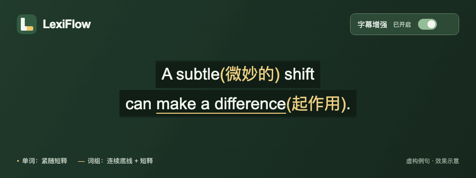

# LexiFlow

**看 YouTube 英文视频时，不用暂停查词。** 英文字幕照常显示，值得提示的单词或短语旁会出现简短中文释义，不翻译整句。

*图中字幕是虚构示例。*

## 两步安装

准备好 **M 芯片 Mac、已启动的 Podman 和 Chrome**。

1. 打开[正式发行页](https://github.com/iampkuhz/lexiflow/releases)，复制所选发行版本里的 `podman run` 命令，在终端运行。首次启动会自动准备词库。
2. 下载**同一发行版本**的 Chrome 扩展 ZIP 并解压。打开 `chrome://extensions`，开启「开发者模式」，点击「加载已解压的扩展程序」，选择解压后含 `manifest.json` 的目录。

扩展弹窗显示「正式就绪」后，打开 YouTube 视频、开启 **CC** 并选择英文字幕。不用下载源码、手动导入词库或配置模型。

## 日常使用

- 弹窗可开关当前页的字幕增强，并显示本机常见词阈值、手动隐藏数量和后端状态；在管理页设置前 1000、1500（默认）或 2000 词的提示阈值。
- 如果弹窗提供「管理提示」，可以隐藏不需要的提示、恢复已隐藏词条，也可以按词频查阅词库。个人选择只保存在本机，不上传。
- 本机服务不可用时，仍可正常看英文字幕。

[查看完整安装、启停、更新和排障说明](docs/user/podman-macos.md)
