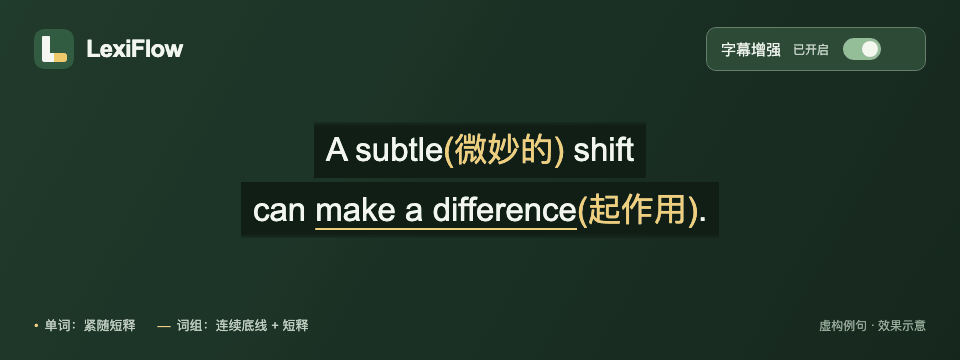

# LexiFlow

看 YouTube 英文视频时，生词旁直接显示中文短释，不用切走查词。

> 效果示意：虚构字幕中的生词提示。



<a id="docker-安装与使用"></a>

## 两步使用

前提：**macOS Apple Silicon、Podman 已安装并运行、Chrome 已安装**。Podman 的安装和启动不包含在以下两步中。

1. 打开[正式 Release](https://github.com/iampkuhz/lexiflow/releases)，复制对应版本正文中的一条 `podman run` 命令。命令按已验收镜像 digest 固定，自动拉取镜像、创建命名卷、初始化资料并启动一个容器。
2. 下载同一 Release 的 Chrome 插件 ZIP，解压到稳定目录，在 `chrome://extensions` 开启开发者模式，点击“加载已解压的扩展程序”。启用后自动连接 `127.0.0.1:18080`；弹窗核对软件、协议和资料身份，显示“正式就绪”后即可使用。

无需下载源码或主安装包，无需安装 Java、Node、Python、Compose 或独立数据库，也无需填写密码、导入词库、编辑配置或预先建卷。ZIP 是加载已解压扩展的交付格式，不是 Chrome Web Store 一键安装；不修改浏览器策略。

运行容器为 `lexiflow-release`，卷为 `lexiflow-release-data`；数据库只在容器内连接，宿主只暴露 loopback API。停止与启动保留资料：

```sh
podman stop --time 45 lexiflow-release
podman start lexiflow-release
```

同名容器、端口或未知卷冲突时不要使用 `--replace` 或删除数据绕过。初始化失败和不兼容资料不能视为就绪；查看[使用与排障](docs/user/podman-macos.md)。观看期间只查询已发布资料，不调用模型；后端不可用时英文字幕继续显示，本机显式抑制偏好不上传。

## 开发与发行

本地开发使用独立名字、端口 `18081` 和开发数据，不与正式安装混用。入口见[本机开发](docs/scenarios/local-development.md)；维护者见[发行生命周期](docs/scenarios/docker-release.md)与[正式发布](docs/scenarios/github-actions.md)。检查、候选和正式发布是不同证明边界，状态只见[执行状态](docs/roadmap/master-plan/phase2/status.md)。
