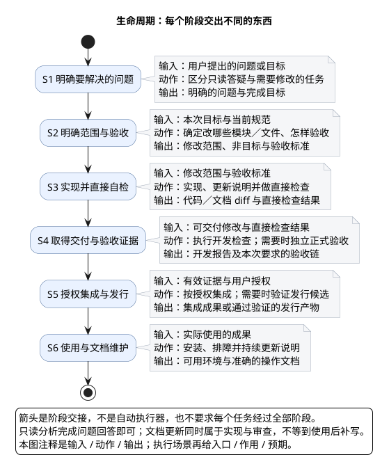

# 1. 仓库生命周期：从问题到交付与维护

**先明确任务，再按阶段推进。** 功能变更、文档维护和工程改进都适用；优化门禁只是其中一种任务，不是必经步骤。

## 1.1. 选择阅读路线

- **先认识工程文件。** 从[工程目录与生命周期](system/engineering.md)看真实脚本如何串联，再从[文件编号索引](reference/scripts.md#16-文件编号索引)回到源码。
- **按当前任务操作。** 从下方[生命周期场景](#12-一条生命周期按交接产物下钻)选择阶段；参数和单项检查再查 [Reference](reference.md)，不必先读完全部 Harness。

修改中取得的是**开发反馈**，宣布任务完成需要本次要求的**任务验收**，发布确定候选另走**正式发行**。三者的入口与证明边界见[执行门禁场景](scenarios/run-repository-gates.md)；全仓基线是检查范围，不是另一种交付目标。

整体治理关系与产品运行架构是不同视角：先理解工程职责请读[三体系总览](system/engineering.md)，了解产品边界请读[系统总览](system.md)。

## 1.2. 一条生命周期，按交接产物下钻

总图的三行注释是“输入、动作、输出”；执行场景的三行注释是“入口、作用、预期”。抽象阶段不设置脱离任务范围的统一耗时。

| 阶段 | 做什么／交出什么 | 按需入口 |
| --- | --- | --- |
| S1 明确问题 | 明确本次目标，分清答疑还是需要修改 | [产品说明](system/experience.md)、[系统说明](system.md) |
| S2 明确范围与验收 | 确定涉及的模块、文件、非目标与验收标准；适用于所有变更 | [任务与工作包](scenarios/delegate-work.md)、[现行约束](../harness/README.md) |
| S3 实现并直接自检 | 修改功能、文档或工程工具，交出 diff 与直接检查结果 | [修改导入逻辑](scenarios/change-lexicon-import.md)、[优化门禁](scenarios/optimize-repository-gates.md)、[本机开发](scenarios/local-development.md) |
| S4 取得交付与验收证据 | 执行现有门禁，取得开发报告；需要时取得正式验收链 | [编码后执行门禁](scenarios/run-repository-gates.md) |
| S5 授权集成与发行 | 按用户授权集成；需要发行时另验真实候选 | [PR 检查／正式发行](scenarios/github-actions.md)、[安装与更新](scenarios/docker-release.md) |
| S6 使用与文档维护 | 安装、排障，持续维护与行为一致的说明 | [用户操作](user/podman-macos.md)、[导入资料](scenarios/lexicon-import.md)、[排障](reference/troubleshooting.md)、[图文维护](scenarios/maintain-documentation.md) |

一个任务可以跨多个阶段；只读答疑完成回答即可。计划和状态见 [roadmap](roadmap/master-plan.md)，日常使用见 [user](user/podman-macos.md)。

## 1.3. 为什么这样分阶段

- **S2：明确范围与验收。** 事实、修改范围和成功标准一起确认，不拆成两次“冻结”。
- **S3／S4：实现反馈与交付证明。** 直接检查先修错；开发检查补齐风险覆盖；Formal 另做独立验收。详见[执行场景](scenarios/run-repository-gates.md)。
- **S6：持续维护。** 文档随实现更新、随交付复核，使用期间继续维护。

## 1.4. 知识放在哪里

约束 Agent 行为的规则放 Harness；面向读者的解释与操作放 docs；未决设计放状态页。

| 内容 | 唯一真源／维护入口 |
| --- | --- |
| 工作范围、身份、风险、Git 与结果规则 | [AGENTS.md](../AGENTS.md)、[Harness](../harness/README.md) |
| 文档原则与图源制作合同 | [documentation-policy](../harness/documentation-policy.md) |
| 产品与领域长期不变量 | [OpenSpec 产品架构规范](../openspec/specs/product-architecture/spec.md) |
| 执行流程／优化任务 | [执行场景](scenarios/run-repository-gates.md)／[优化场景](scenarios/optimize-repository-gates.md)；优化页引用执行页，不复制子流程 |
| 脚本实际行为与文件职责 | 源码与直接测试；[Scripts 索引](reference/scripts.md) |
| 未决设计与当前状态 | [问题台账](roadmap/master-plan/phase2/status.md) |

系统事实在 [system](system.md)，任务步骤在 [scenarios](scenarios/run-repository-gates.md)，命令与字段从 [Reference](reference.md) 查阅；[roadmap](roadmap/master-plan.md) 维护计划和状态，[user](user/podman-macos.md) 面向使用者。同一主题只保留一处正文，原则见 Harness，不在各目录重复维护。

