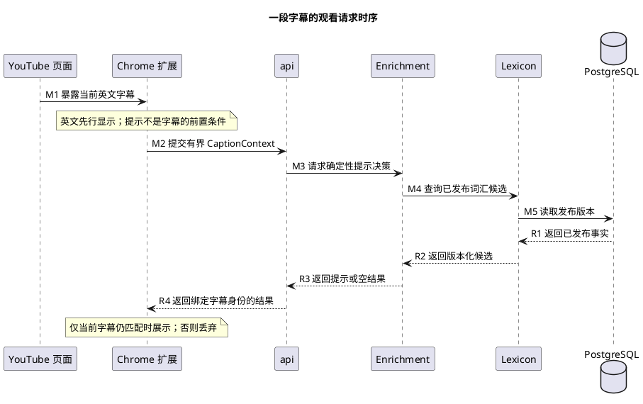
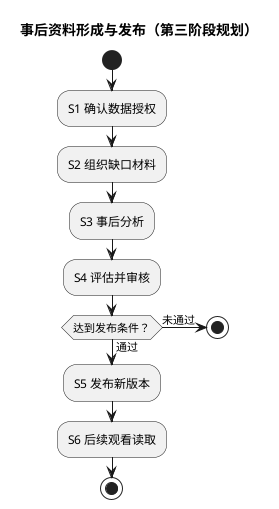

# 1. 字幕提示与事后改进流程

[架构总览](overview.md) → 流程总览。本文说明观看与事后资料改进如何通过发布衔接。

本页回答“观看与资料更新为何不是同一工作流”。观看以当前字幕为输入，产出提示或空结果；独立事后改进产出经审核发布的资料版本，只有发布后的版本供后续观看读取。事后链是[第三阶段](../roadmap/master-plan/improvement.md)规划，不表示分析任务或模型接口已实现。精确输入和安全边界以本页所链合同为准。

## 1.1. 观看：仅从已发布资料作决定

英文先在本机显示。扩展提交有界输入，`:api` 协调 Enrichment 经 Lexicon 公开合同读取已发布资料；确定性规则返回提示或空结果。扩展仅展示仍对应当前字幕的结果。观看不调用模型，也不创建待补全工作。输入限制见[字幕内容合同](caption-contract.md)，候选及提示条件见[共享词库合同](lexicon-contract.md)和[语义资料合同](semantic-contract.md)，复用与降级见[运行安全](runtime-safety.md)。

### 1.1.1. 参与者与调用顺序

这张时序图只画**一次当前字幕请求**。英文在 M1 后已经可见，M2—R4 都是可降级的附加工作，不构成字幕显示的前置条件。

M1—R4 描述一次观看请求：来源适配形成输入，唯一 API 装配业务用例，Enrichment 查询已发布资料并作提示决策，客户端关联当前字幕后展示。图省略可重建缓存；缓存只复用发布资料，不改变决策合同。具体字段与适用限制见图后引用的唯一合同。

### 1.1.2. 失败与降级

不能可靠取得字幕或身份、输入不合格、资料不适用、服务失败，或响应已不对应当前字幕时，系统不伪造来源、不提示或丢弃旧响应，英文继续显示。输入细节见[来源适配合同](source-contract.md)与[字幕内容合同](caption-contract.md)；提示资格和失效边界分别见[共享词库合同](lexicon-contract.md)、[语义资料合同](semantic-contract.md)和[运行安全](runtime-safety.md)。

### 1.1.3. 合同与代码位置

源端采集与展示分别在 [`extension/src/caption-source.ts`](../../extension/src/caption-source.ts)、[`extension/src/overlay.ts`](../../extension/src/overlay.ts)；HTTP 映射在 [`CaptionHintController.java`](../../backend/product/api/src/main/java/io/lexiflow/api/hints/CaptionHintController.java)，用例在 [`EnrichCaptionUseCase.java`](../../backend/product/enrichment/src/main/java/io/lexiflow/enrichment/application/caption/EnrichCaptionUseCase.java)，领域判断在 [`DeterministicHintPolicy.java`](../../backend/product/enrichment/src/main/java/io/lexiflow/enrichment/domain/policy/DeterministicHintPolicy.java)。这些位置帮助追踪当前实现，不替代[长期产品架构规范](../../openspec/specs/product-architecture/spec.md)或[状态页](../roadmap/master-plan/phase2/status.md)的交付事实。

## 1.2. 资料准备：审核发布后才可被后续观看读取

下图是第三阶段的**规划边界**，不是已上线任务状态机。图中“事后分析”可以包含模型，但并非必须；它不能被当前字幕请求触发。

该链路须先有独立授权；观看请求不构成资料取得或外发授权。材料经来源、适用性与质量核验并审核后，才能通过公开合同发布；失败时保留当前发布版本，不回补当前字幕。发布与审核要求见[语义资料合同](semantic-contract.md)，现有词库事务边界见[词库持久化模型](data-model.md)。

## 1.3. 第二阶段的效率工作不改变两条链

[第二阶段](../roadmap/master-plan/performance.md)可优化既有资料的查询、批量准备和复用，但不能以性能名义让观看依赖第三阶段模型在线运行。Redis、本机 L1 和投影都可重建；资料版本、来源修订或规则变化时旧结果不可复用。两条链的领域归属与禁止跨越的依赖见[模块边界](boundaries.md)。

## 1.4. 按问题进入准确合同

输入来源或身份不可靠，查[来源适配](source-contract.md)和[字幕内容](caption-contract.md)；不知道候选何时可提示，查[共享词库](lexicon-contract.md)和[语义资料](semantic-contract.md)；怀疑旧结果或缓存，查[运行安全](runtime-safety.md)。这些是本流程节点的 Reference，不是需要顺序执行的附加步骤。进度与证据只见[状态页](../roadmap/master-plan/phase2/status.md)。
