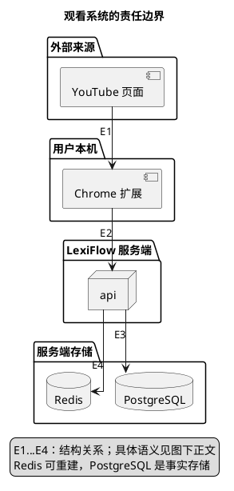

# 1. 系统总览

[文档首页](../README.md) → [产品说明](../product/product-brief.md) → 系统总览。本文给出系统边界、核心模型与模块入口；具体字段及限制以链接所指合同为准。

LexiFlow 是 Java 25 Modular Monolith：Chrome 扩展读取 YouTube 英文字幕，唯一 `:api` 装配 HTTP 与产品模块；PostgreSQL 保存发布事实。观看仅读取已发布资料并运行确定性规则，第三阶段规划的事后资料改进与观看隔离，审核发布后的新版本才供后续观看使用。

## 1.1. 系统边界

下图表示组件与资料流，不表示 Java 依赖。数据隐私、缓存复用和失效规则见[运行安全](runtime-safety.md)。

- **E1：** 扩展读取页面已渲染英文，不改写来源英文节点；平台 DOM 类型留在来源适配器。
- **E2：** 扩展以有界字幕输入请求提示；英文不等待请求，响应可为空。
- **E3：** PostgreSQL 保存词库事实与发布版本；各业务模块仅经公开合同访问所属数据。
- **E4：** Redis 与浏览器缓存均可重建，不取代事实存储或发布校验。

观看不保存历史、不上传本机抑制偏好。字幕原文、观看 URL、凭据与模型载荷不得借缓存、日志或指标越过信任边界；细则见[运行安全](runtime-safety.md)。

## 1.2. 核心业务模型

Lexicon 保存跨内容复用的词汇知识及发布版本；Enrichment 接收 `CaptionContext`，据已发布资料决定当前词段是否提示。词条命中不等于提示，提示也不等于改变词库事实。资料改进须经 Lexicon 公开发布合同后才影响后续观看。

两个业务领域各自包含 `domain` 与 `application` 包，`:adapters` 实现技术端口，`:api` 是唯一 Spring Boot 组合根。后台用例若增加，仍由所属业务模块实现并由同一应用装配，不新建产品 worker 进程。依赖方向、项目清单及代码位置见[模块边界](boundaries.md)；持久化字段见[词库持久化模型](data-model.md)。

## 1.3. 两条流程与唯一合同

观看流程见[字幕提示与事后改进流程](flows.md)。各项精确事实仅在合同正文维护：来源取得、输入字段与限制见[字幕输入合同](caption-contract.md)；词条、查询与发布见[lexicon contract](lexicon-contract.md)；语义资料资格见[semantic contract](semantic-contract.md)；缓存、安全与观测见[runtime safety](runtime-safety.md)。本页不复制这些合同字段或算法。

长期架构约束以[产品架构规范](../../openspec/specs/product-architecture/spec.md)为准；划分原因与复审条件随[模块边界](boundaries.md)、[产品取舍](../product/product-brief.md)及[语义发布](semantic-contract.md)就近维护，不再另建重复决定的汇总页。当前实现状态只见[状态页](../roadmap/master-plan/phase2/status.md)。

