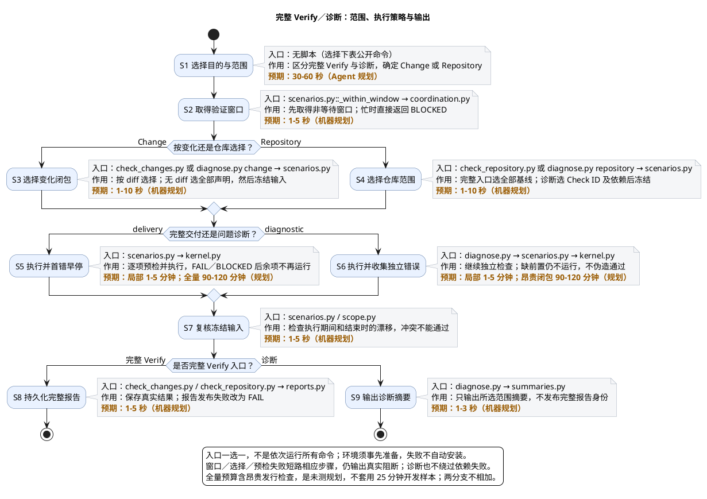
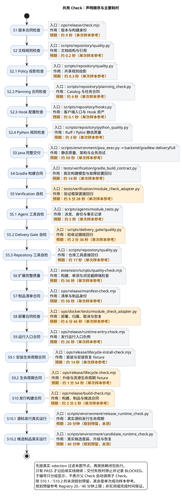

# 1. Verify：选择、执行与报告

> 位置：[工程地图](../overview.md) → [开发交付 S2](../change-delivery.md) → Verify。前置是实际源码和检查声明；输出是 verification report，不是正式 receipt。

## 1.1. 风险驱动的开发入口与完整基线

日常编码的先后顺序看[执行门禁场景](../scenarios/run-repository-gates.md)。下图只展开显式完整 Verify 与问题诊断，二者不是日常必须叠跑的步骤。



| 节点 | 核心作用 | 入口／源码 |
| --- | --- | --- |
| S1 选择目的 | 选完整 Verify 或问题诊断，以及 Change／Repository 范围 | `python3 scripts/check_changes.py`、`python3 scripts/check_repository.py`、`python3 -m scripts.verification.diagnose change\|repository` |
| S2–S4 窗口与范围 | 取得窗口后选择检查闭包并冻结输入 | [scenarios.py](../../../scripts/verification/scenarios.py)、[scope.py](../../../scripts/verification/scope.py) |
| S5／S6 执行策略 | 交付首错早停；诊断继续独立检查，均不绕过前置要求 | [scenarios.py](../../../scripts/verification/scenarios.py)、[kernel.py](../../../scripts/verification/kernel.py) |
| S7–S9 复核与输出 | 复核漂移；完整入口持久化报告，诊断只输出范围摘要 | [reports.py](../../../scripts/verification/reports.py)、[diagnose.py](../../../scripts/verification/diagnose.py) |

预算按所选闭包判断，局部与全量不是稳定性能区间；全量 90–120 分钟是包含昂贵发行检查的未测规划，不是开发 Stop 的预期。环境安装、下载和人工等待另计。

公开日常开发入口按真实 diff、文件内容和闭包自动评估风险，不接受 root、base、check ID 或风险覆盖参数：

```bash
python3 -m scripts.verification.development
```

机械或局部功能改动执行 `development-change`（按变更触发检查）；高风险工程改动额外执行 `development-baseline`。分类取决于真实 diff/闭包和内容，不信任 Task 名称。高风险不等于正式发行验证。

完整 Change/Repository Verify 原语仍供显式完整基线与发行 CI 使用：Change Verify 按 diff 选择 `change-targeted` 检查；Repository Verify 执行 `repository-baseline`。它们不是每项日常开发的无条件要求。无 diff 时，Change Verify 会选择全部声明，不把“工作区干净”当成无需验证。

需要显式完整 Change 自查时，阅读选中原因、覆盖缺口和 scope_review：

```bash
python3 scripts/check_changes.py
```

再检查完整仓库基线；不读取 Task、身份或批准记录：

```bash
python3 scripts/check_repository.py
```

比较基线与风险/检查闭包由开发入口固定并冻结。定向诊断只用于定位；开发自检、完整 Verify 与正式 Gate 的 PASS 各自绑定不同输入和证明范围，不可互代。

### 1.1.1. 日常功能研发不等待正式发行

执行边界以 [Harness](../../../harness/README.md) 为准。功能开发阶段先取得相关模块反馈，不必先完成 ZIP、镜像、双架构发布或真实资料分发验收；源码启动与扩展加载见[本地体验](../operations/local-experience.md)。

开发入口自动推导所需范围；需要定位单个模块问题时，可使用诊断入口：

```bash
# 后端完整模块检查；仍需要 Java 25 和隔离 PostgreSQL/Redis 测试环境。
.local/lexiflow-python/bin/python -m scripts.verification.diagnose repository --check-id eng.backend.delivery

# 扩展质量检查；声明依赖会同时纳入后端检查，不是仅做前端单测。
.local/lexiflow-python/bin/python -m scripts.verification.diagnose repository --check-id eng.extension.quality
```

测试环境按[验证环境](../operations/verification-environment.md)准备，不能接入真实用户数据库。诊断不会自动安装依赖，也不会因为缺少环境而跳过所选模块的必需检查。

诊断仅用于定位，不证明发布可用；报告须说明实际范围，不可作为完整 Verify 报告。正式发行检查由 Task `required_check_ids` 命中 `harness/ci-policy.yaml` formal check 集合触发，并仍执行完整 Repository baseline。

### 1.1.2. 实现者直接自检

按实际改动选择相关静态、编译和直接回归；选择步骤与各语言入口统一见[执行门禁场景 A](../scenarios/run-repository-gates.md)。跨模块可以选择多类检查，失败先修实现；不要惯例性地叠跑完整 adapter、development 和 Stop。直接自检不签发 receipt，也不替代开发风险检查。

## 1.2. 从阶段到子能力

冻结前选定完整检查闭包；执行前后和结束时核对输入。单个检查缺运行环境时不执行其命令，仍汇总 BLOCKED。命令失败、覆盖不足、输入漂移均不能被其他检查的成功抵消。

声明以轻量反馈优先的稳定顺序组织，依赖闭包仍优先：版本、文档、policy、planning、Hook 资产与 Python 静态检查先运行，随后是后端交付，再执行构建合同、工具框架自检与其他产品/发行检查。独立规则检查不以整个工具测试套件为前置，但显式冻结检查器源码；工具源码变更仍选择其模块测试，完整 repository baseline 保留所有检查。正常交付仍 fail-fast，后续未执行项记为 BLOCKED；定向诊断可汇总独立问题，不能据此签发完整交付结论。

声明源码通过仓库目录描述符逐层读取，不跟随文件或祖先目录的符号链接；特殊文件、私有配置入口及读取期间的身份变化均拒绝。文件快照绑定相对路径、内容摘要、字节数和执行位，缺失或不安全输入不能冻结为 PASS。报告消费时重新核对完整快照，不能仅保留指纹而改写文件描述。这是声明输入的安全读取合同，不证明构建的实际读取闭包、外部候选或跨主机来源已经完整绑定。

同窗多 profile 仅在输入、配置、环境、window、runner 和 context 一致时可复用；未知副作用默认不可复用，跨视图须显式 `transaction_reuse=true`。runtime transport、失败及跨交付结果不复用；自检不复用为 Formal validation，同视图 alias 保持原语义。

跨视图工具身份由共用 Environment helper 解析：绑定实际解释器、声明工具在子进程 PATH 中的解析目标、真实路径及内容摘要，而不只比较 PATH 字符串。有限能力 `python-package-yaml`、`posix-lock-tool`、`sha256-tool` 分别绑定实际 PyYAML 包、当前平台锁工具和脚本所选摘要工具。执行前后与报告消费时重新核对；工具或包字节变化、来源日志损坏、输入漂移均不能投影旧 PASS。只记录身份描述与摘要，不记录秘密环境值；这不等于任意外部服务或所有操作系统状态的认证。

声明工具与冻结源码必须覆盖测试实际读取；合成 fixture 的私有输出若只在同一检查内消费，并不天然要求每个视图重跑。真实服务、浏览器安装或未完整绑定的质量工具依赖保持不可复用，不能仅凭测试名称放行。

### 1.2.1. 共用检查执行链与耗时

日常开发、完整 Verify、Formal validation 和 CI 复用这些能力，但选择范围和身份结论不同。先由真实 `selection` 过滤节点，再按依赖闭包执行；本图不是要求每次把全部节点都跑完。子编号仅分组，不表示父 Check 调用子 Check。

时间取自本机 Apple Silicon、项目 Python／Java 25 环境中的一个完整成功开发批次（`development-change` 和 `development-baseline`；报告 ID `00fd7d32-8132-4bc1-adca-9a104e804f58`、`3ebc011b-a56b-4317-bf5e-97a2530d1c10`）。它们是单次参考，不是稳定区间、CI 预期或本次输入的验收；环境准备、下载、人工等待另计。图中淡橙只强调分钟级耗时，不表示 FAIL。



图与表列出实现文件、作用及预期参考；公开执行命令以表为准，内部实现文件不是要求额外运行的 CLI。S10.1／S10.2 尚无完整成功实测，各预留 20／40 分钟，参考 Registry 单项上限；这是规划预算，不保证实际可在预算内完成。其他节点使用单次样本参考；真正的触发路径、依赖、输入、环境和结果合同仍由 [module-checks.yaml](../../../harness/module-checks.yaml) 维护，表格不定义第二套规则。

| 节点 | 核心作用 | 入口链接／样本 |
| --- | --- | --- |
| S1 | 版本与身份合同 | `node ops/release/check.mjs`；[check.mjs](../../../ops/release/check.mjs)；单次约 9 秒 |
| S2 | 文档结构、链接与规则 | `python3 -m scripts.repository.quality --mode docs`；入口 [quality.py](../../../scripts/repository/quality.py)；样本约 0.2 秒 |
| S2.1 | 确定性投影 | `python3 -m scripts.repository.quality --mode policy`；入口 [quality.py](../../../scripts/repository/quality.py)；样本约 0.3 秒 |
| S2.2 | Catalog 合同 | `python3 -m scripts.repository.quality --mode planning`；入口 [quality.py](../../../scripts/repository/quality.py)；样本约 6 秒 |
| S2.3 | Hook 入口资产 | `python3 -m scripts.repository.quality --mode hooks`；入口 [quality.py](../../../scripts/repository/quality.py)；样本约 0.1 秒 |
| S2.4 | scripts 静态质量 | `python3 -m scripts.repository.quality --mode python`；入口 [quality.py](../../../scripts/repository/quality.py)；样本约 3 秒 |
| S3 | Java 完整模块检查 | [scripts/environment/java_exec.py](../../../scripts/environment/java_exec.py) → `backend/gradlew deliveryFull`；[Java 检查](../reference/java-checks.md)；单次约 59 秒（含聚合子任务） |
| S4 | 构建模型与前置故障回归 | [tests/verification/gradle_build_contract.py](../../../tests/verification/gradle_build_contract.py)；单次约 14 秒 |
| S5 | 验证器自身回归 | [tests/verification/module_check_adapter.py](../../../tests/verification/module_check_adapter.py)；单次约 5 分 28 秒 |
| S5.1 | 派发／身份／结果合同 | [scripts/agents/module_tests.py](../../../scripts/agents/module_tests.py)；单次约 3 秒 |
| S5.2 | 验收证据链回归 | [scripts/delivery_gate/quality.py](../../../scripts/delivery_gate/quality.py)；单次约 2 分 36 秒 |
| S5.3 | 仓库工具回归 | `python3 -m scripts.repository.quality --mode tests`；入口 [quality.py](../../../scripts/repository/quality.py)；样本约 17 秒 |
| S6 | 构建、单测、真实跨端检查 | `node extension/scripts/quality-check.mjs`；单次约 56 秒（含子步骤） |
| S7 | 清单与制品身份 | `node ops/release/manifest-check.mjs`；单次约 58 秒 |
| S8 | 部署、取消、归属与恢复回归 | [ops/docker/tests/module_check_adapter.py](../../../ops/docker/tests/module_check_adapter.py)；单次约 6 分 46 秒（含 Python／Node 套件） |
| S9 | 运行入口负例 | `node ops/release/runtime-entry-check.mjs`；单次约 26 秒 |
| S9.1 | 首装 fixture | `node ops/release/lifecycle-install-check.mjs`；单次约 14 秒 |
| S9.2 | 升级／资源 fixture | `node ops/release/lifecycle-check.mjs`；单次约 1 分 54 秒 |
| S10 | 构建、制品与候选 fixture | `node ops/release/build-check.mjs`；单次约 2 分 2 秒（非发行总时间） |
| S10.1 | 真实源码发行生命周期 | [scripts/environment/release_runtime_check.py](../../../scripts/environment/release_runtime_check.py)；Formal only，预留 20 分钟（规划，未测） |
| S10.2 | 真实候选首装、升级、恢复 | [scripts/environment/candidate_runtime_check.py](../../../scripts/environment/candidate_runtime_check.py)；Formal only，预留 40 分钟（规划，未测） |


计算一次交付的等待时间，应以实际物理执行及窗口为准；同事务复用不再次累加，父入口与子节点不相加，不跨交付复用旧 PASS。声明或实现变化后须重新判断样本适用性，不把节点样本总和当作所有场景的预计完成时间。


## 1.3. 从子能力定位文件

- [check_changes.py](../../../scripts/check_changes.py)、[check_repository.py](../../../scripts/check_repository.py)：薄 CLI，解析参数、调用公开场景、持久化报告；不理解测试类。
- [declarations.py](../../../scripts/verification/declarations.py)：加载 module-checks，验证声明与 result contract；不执行模块。
- [scope.py](../../../scripts/verification/scope.py)：diff、triggers、依赖闭包与覆盖。要问“为何这个文件触发另一个模块”，从这里查。
- [scenarios.py](../../../scripts/verification/scenarios.py)：组织选择、冻结、执行和最终复核。它负责顺序，不替模块编写检查规则。
- [Environment API](../../../scripts/environment/__init__.py)：诊断必需运行环境及受控子进程变量，不安装依赖。
- [kernel.py](../../../scripts/verification/kernel.py)：进程、超时、输出 artifact 与 result contract。Java 内容只由 Gradle 检查。
- [input_snapshot.py](../../../scripts/verification/input_snapshot.py)：以不跟随链接的目录描述符读取声明源码，绑定字节和执行位并拒绝读取竞态；由既有内核调用，不是独立 Gate 或公开命令。
- [reports.py](../../../scripts/verification/reports.py)：报告完整性与不可变持久化。外部从 [public API](../../../scripts/verification/__init__.py) 读取，而不是信任手写 PASS JSON。

完整内部职责表见[Scripts Reference](../reference/scripts.md)。模块的直接测试见 `tests/verification/`；它们证明引擎行为，不代表所有产品检查都已运行。

## 1.4. 去重、结果和交接

同次验证中，命令、配置及输入闭包相同的检查可以只执行一次，结果映射到相应 check ID；不能仅按命令字符串去重，也不能复用旧报告冒充独立验证。

报告在 ignored `tmp/quality/verification-reports/`。`PASS` 只证明该报告冻结的输入；必需环境缺失是 `BLOCKED`，检查断言或输入冲突是 `FAIL`。未执行、skip、零测试和缺失结果不能 PASS。具体 code 以结果字段为准，定位步骤见[排障](../troubleshooting.md)。

下一步：需要正式验收时进入 [submit](delivery-gate.md)，并交出风险绑定的开发验证报告；否则回到[交付主干](../change-delivery.md)记录实际自查范围。

baseline/change 声明须保持相同执行 contract；去重键含 result_contract，故 completeness_guarantee 漂移也会触发重跑，不能只比较命令文本。

## 1.5. 交付触发与语言检查

交付使用风险驱动的开发入口或客户端 Stop；完整 Verify 只在显式要求时运行，不在每次工具调用后重复扫描。backend 变更选择 Gradle deliveryFull，保留 Spotless、Checkstyle、PMD、Java source/Javadoc、架构与业务测试；scripts 变更选择 Ruff、Pylint 中文 docstring 检查和模块测试。规则真源分别是 [python-quality.toml](../../../harness/python-quality.toml) 与 [python-docstrings.toml](../../../harness/python-docstrings.toml)，工具与环境固定在 requirements-dev。

交付 Hook 自动执行风险所需 profiles 并返回真实结果，但不替代检查声明、结果语义约束或独立正式验收；启用、阶段边界与恢复方式见[交付 Hook](hooks.md)。
