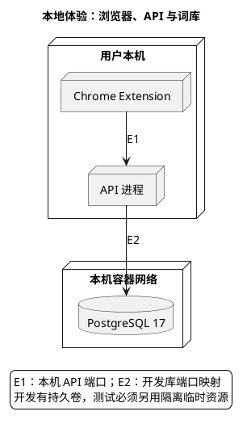

# 1. 运行与环境：把体验、资料和测试分开

> 位置：[文档首页](../README.md) → [工程地图](overview.md) → 运行与环境。启动 API、导入词库和准备隔离测试是不同操作；有副作用的动作不能隐藏在只读 Verify 内。

## 1.1. 先选择运行目的

| 任务 | 入口命令或操作 | 成功判据 |
| --- | --- | --- |
| 启动源码体验 | [本机体验](operations/local-experience.md)；`python3 -m scripts.environment.start_api` | API 健康且日志显示已发布词库；浏览器扩展报告就绪 |
| 准备或重建词库 | [词库导入](operations/lexicon-import.md)；`lexiconValidate` 后按需 `lexiconRebuild` | 来源校验通过；发布事务提交且资料版本可查询 |
| 执行扩展工程测试 | [扩展 E2E](operations/extension-e2e.md)；在 `extension/` 下运行 `npm test`、`npm run e2e` | 合成页面与本机夹具测试完成；不代表真实观看验收 |
| 检查 PR | [GitHub Actions](operations/github-actions.md)；`python3 -m scripts.verification.ci quick --base <完整commit>` | quick 全部必需检查 PASS；不代表完整 Verify 或 Formal |
| 准备正式候选 | [GitHub Actions](operations/github-actions.md)；发行标签 workflow | 候选和完整 Verify 完成后仍需独立 Gate 与人工批准 |
| 准备隔离验证资源 | [验证环境](operations/verification-environment.md)；按需准备本机镜像与运行时 | 隔离资源就绪；资源就绪本身不是验证 PASS |

## 1.2. 正常本机体验的资源关系

E1 的 API 端口由扩展构建参数与 host permission 共同绑定，默认 18080；E2 读取 PostgreSQL 已发布资料。Redis 与未来后台任务不属于观看最短请求链的必经节点。开发 compose 有持久数据卷，测试不能把它当临时资源使用。

## 1.3. 环境准备与验证的边界

首次 Python 环境使用 requirements-dev.txt 显式创建本机 venv；之后用该解释器执行仓库命令。Java 始终通过 java_exec 和仓库 Gradle Wrapper。依赖安装、容器创建、skill 链接都属于显式准备，不在 Verify 内自动发生。

准备失败时记录 BLOCKED 并指出具体资源；业务断言失败另记 FAIL。验证日志不纳入真实字幕、观看历史、密钥或模型输入输出；本机 API 的逐请求中英结果日志属于受用户授权的敏感运行数据，不提交仓库。下一步进入对应操作，或回到[交付主干](change-delivery.md)。
