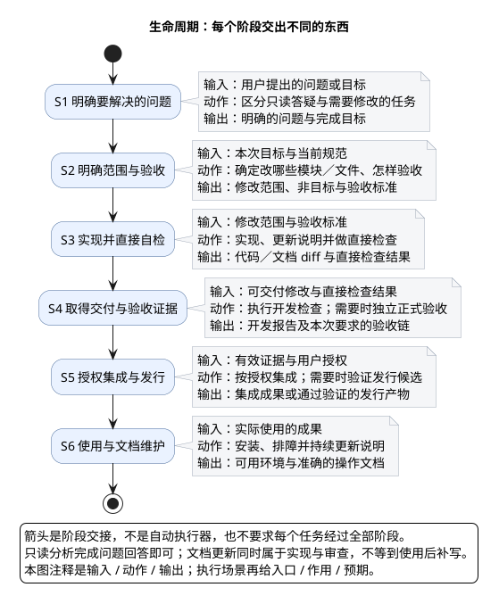

# 1. 仓库生命周期：从问题到交付与维护

**先明确任务，再按阶段推进。** 功能变更、文档维护和工程改进都适用；优化门禁只是其中一种任务，不是必经步骤。

## 1.1. 一条生命周期，按交接产物下钻

总图的三行注释是“输入、动作、输出”；执行场景的三行注释是“入口、作用、预期”。抽象阶段不设置脱离任务范围的统一耗时。

| 阶段 | 做什么／交出什么 | 按需入口 |
| --- | --- | --- |
| S1 明确问题 | 明确本次目标，分清答疑还是需要修改 | [产品说明](../product/product-brief.md)、[系统说明](../architecture/overview.md) |
| S2 明确范围与验收 | 确定涉及的模块、文件、非目标与验收标准；适用于所有变更 | [任务与工作包](agent-workflow.md)、[现行约束](../../harness/README.md) |
| S3 实现并直接自检 | 修改功能、文档或工程工具，交出 diff 与直接检查结果 | 修改导入：[功能变更场景](scenarios/change-lexicon-import.md)；优化门禁：[优化场景](scenarios/optimize-repository-gates.md) |
| S4 取得交付与验收证据 | 执行现有门禁，取得开发报告；需要时取得正式验收链 | [编码后执行门禁](scenarios/run-repository-gates.md) |
| S5 授权集成与发行 | 按用户授权集成；需要发行时另验真实候选 | [交付](change-delivery.md)、[发行](operations/github-actions.md) |
| S6 使用与文档维护 | 安装、排障，持续维护与行为一致的说明 | [用户操作](../user/podman-macos.md)、[排障](troubleshooting.md)、[图文维护](reference/documentation.md) |

一个任务可以跨多个阶段；只读答疑完成回答即可。计划和状态见 [roadmap](../roadmap/master-plan.md)，日常使用见 [user](../user/podman-macos.md)。

## 1.2. 为什么这样分阶段

- **S2：明确范围与验收。** 事实、修改范围和成功标准一起确认，不拆成两次“冻结”。
- **S3／S4：实现反馈与交付证明。** 直接检查先修错；开发检查补齐风险覆盖；Formal 另做独立验收。详见[执行场景](scenarios/run-repository-gates.md)。
- **S6：持续维护。** 文档随实现更新、随交付复核，使用期间继续维护。

## 1.3. 知识放在哪里

约束 Agent 行为的规则放 Harness；面向读者的解释与操作放 docs；未决设计放状态页。

| 内容 | 唯一真源／维护入口 |
| --- | --- |
| 工作范围、身份、风险、Git 与结果规则 | [AGENTS.md](../../AGENTS.md)、[Harness](../../harness/README.md) |
| 文档原则与图源制作合同 | [documentation-policy](../../harness/documentation-policy.yaml) |
| 产品与领域长期不变量 | [OpenSpec 产品架构规范](../../openspec/specs/product-architecture/spec.md) |
| 执行流程／优化任务 | [执行场景](scenarios/run-repository-gates.md)／[优化场景](scenarios/optimize-repository-gates.md)；优化页引用执行页，不复制子流程 |
| 脚本实际行为与文件职责 | 源码与直接测试；[Scripts 索引](reference/scripts.md) |
| 未决设计与当前状态 | [问题台账](../roadmap/master-plan/phase2/status.md) |

现有目录划分仍在问题台账中评估；本入口不要求读者按 `product/`、`architecture/`、`development/` 顺序阅读。规范补足事项也记录在台账，本次不修改 Harness。
