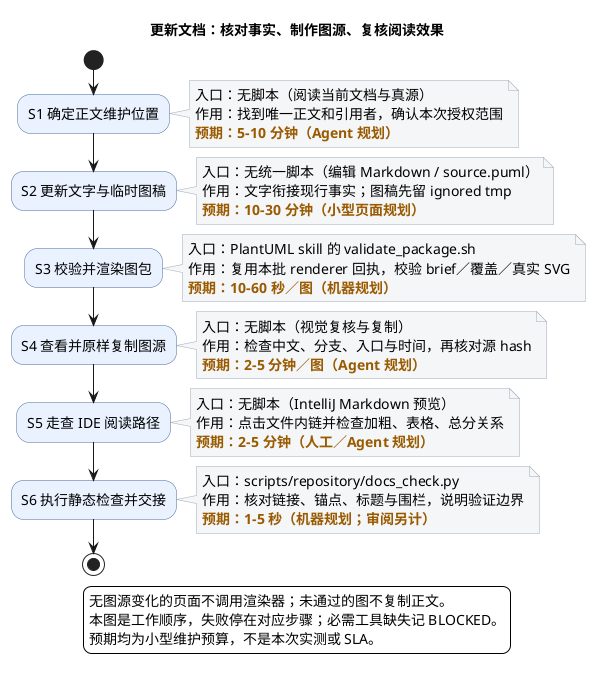

# 1. 图文维护：更新唯一正文并验证阅读效果

> 上级：[Reference](../reference.md)。原则与机器规则见 [documentation-policy](../../../harness/documentation-policy.yaml)；本页只讲实际更新步骤，不新增 Agent 规则。

## 1.1. 从更新到交接



| 节点 | 核心作用 | 操作入口 |
| --- | --- | --- |
| S1 | 找到事实真源、唯一正文与引用者 | [生命周期归属导航](../overview.md)、[documentation-policy](../../../harness/documentation-policy.yaml) |
| S2 | 按实际范围更新正文；图源先写临时稿 | Markdown；本机 `feipi-plantuml-generate-diagram` skill |
| S3 | 执行对应图型的 schema／覆盖／布局／渲染校验 | skill 的 `scripts/validate_package.sh`；一批复用一次 preflight 回执 |
| S4 | 查看图，再原样复制并核对 hash | 正文 fenced `plantuml`；调试产物只留 ignored tmp |
| S5 | 在实际 IDE 中点击内链与查看格式 | IntelliJ Markdown 预览；没有实际点击不能称定位通过 |
| S6 | 静态检查并说明验证范围 | [docs_check.py](../../../scripts/repository/docs_check.py) |

无图源修改不重复渲染；技能不可用或无法视觉复核记 BLOCKED，具体修复次数和失败边界只引用 skill。状态记录见[问题台账](../../roadmap/master-plan/phase2/status.md)，不写进长期操作步骤。

## 1.2. 编辑时查什么

| 本次要改的内容 | 查哪里 | 不做什么 |
| --- | --- | --- |
| Agent 规则／文档原则 | Harness 真源与消费者 | 不在 docs 写第二份机器规则；授权只限 docs 时列待办 |
| 执行某流程 | 对应执行场景／操作页 | 不在优化任务页重复完整执行子图 |
| 优化某流程 | 优化任务与源码／直接测试 | 不把待确认设计写成现行事实 |
| 合同字段与模块行为 | 对应领域合同和源码 | 不在产品价值页、路线图重复维护字段表 |
| 数字耗时 | 既有样本与规划前提 | 不为补数字跑重套件；不把估算当实测或 SLA |

图型按需要选择：阶段分支用 activity，调用交接用 sequence，依赖用 component／architecture，资源用 deployment。state／class 使用 skill 的 fallback 合同，不能冒充 typed 覆盖验证。

图源与正文同处，便于一次审阅，避免独立图片或 `.puml` 链接漂移；IDE 预览或渲染合同出现可复现缺陷时再评估工具方案，规则仍以 Harness 为准。

## 1.3. 在 IntelliJ 里复核

主导航使用相对**文件链接**，例如从 `overview.md` 到 `change-delivery/hooks.md`；带 `#标题片段` 的链接还依赖 IDE 的标题解析。截图中的 “Cannot find header to navigate to” 属于标题定位层，不能直接推断文件不存在。本次样板改用文件链接；保留被外部引用的旧锚点不代表所有 IDE 都识别 HTML alias。

加粗使用 `**短句。** 后文`。结束标记后留空格，避免标点后紧贴汉字而不生效；不要写 `** 文本**`，开始标记内侧空格会破坏加粗。还要看表格列数、围栏和图中命令字面量；静态 slug 检查不能替代预览。

## 1.4. 静态检查与交付边界

从仓库根执行：

```bash
python3 -m scripts.repository.docs_check
```

核对标题层级、文件链接、仍被引用的锚点、围栏和源码引用。静态 PASS 只证明相应结构检查，不证明语义、实际图形或 Formal。文档改动仍按真实风险触发现行交付检查，不能因为只改 docs 就自行豁免，见[执行门禁](../scenarios/run-repository-gates.md)。
