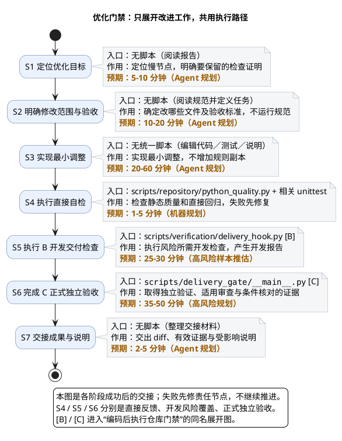

# 1. 场景：优化仓库门禁脚本

> 上级：[仓库生命周期](../overview.md)。只需运行现有检查时，进入[执行门禁场景](run-repository-gates.md)。

**目标：更快反馈，不削弱检查证明。** 本页讲定位与改动；交付执行引用共用流程。

## 1.1. 先看改进工作与交接

本例修改核心门禁逻辑，预算按高风险工程路径估计；实际风险由 diff 和依赖闭包决定。失败先修对应步骤，不继续推进。

| 阶段 | 作用／产物 | 入口／说明 |
| --- | --- | --- |
| S1 定位 | 慢节点与需要保留的证明范围 | 阅读既有报告；[检查声明](../../../harness/module-checks.yaml) |
| S2 定界 | 修改文件列表、非目标与验收要求 | 人工／Agent 定义任务；[现行合同](../../../harness/agent-policy.manifest.yaml)、[OpenSpec](../../../openspec/changes/) |
| S3 实现 | 代码、测试和说明的最小 diff | [Scripts 文件职责](../reference/scripts.md) |
| S4 直接自检 | 静态质量与相关回归结果 | [python_quality.py](../../../scripts/repository/python_quality.py)、[编排直接测试](../../../tests/verification/test_lightweight_orchestration.py) |
| S5 [B] 开发检查 | 风险所需开发报告 | [delivery_hook.py](../../../scripts/verification/delivery_hook.py)；[执行页 1.3 B](run-repository-gates.md) |
| S6 [C] 正式验收 | 独立验证与适用审查的完整证据链 | [delivery_gate/__main__.py](../../../scripts/delivery_gate/__main__.py)；[执行页 1.4 C](run-repository-gates.md) |
| S7 交接 | diff、有效证据与准确说明 | 人工／Agent 整理；Git 另需[授权](../../../AGENTS.md) |

S2 只确定任务，不运行 OpenSpec 或 Harness，也不执行代码扫描。涉及 Java 的修改在 S4 选择 Gradle 直接检查；本例的 Python 改动选择静态质量与相关 `unittest`。

## 1.2. S4、S5、S6 的边界

| 节点 | 检查范围 | 输出 |
| --- | --- | --- |
| S4 直接自检 | 实现者选择相关静态／编译／定点测试，尽早修错 | 直接反馈，不是完整风险报告 |
| S5 [B] 开发检查 | 按真实 diff 与风险闭包执行必需检查 | 开发报告，不是正式 validation |
| S6 [C] 正式验收 | 独立执行冻结计划；review 只读审查；check 核证据 | 正式验收链，不等于已获 Git／发布许可 |

涉及 Hook 行为时选择[对应直接测试](../../../tests/verification/test_delivery_hook.py)，不机械叠跑整个 adapter、development 和 Hook。

## 1.3. 共用执行与设计问题

S5 [B]、S6 [C] 分别进入[执行页](run-repository-gates.md)的 1.3、1.4。CLI 参数留在[能力说明](../change-delivery/delivery-gate.md)；重复覆盖、环境职责与入口设计留在[问题台账](../../roadmap/master-plan/phase2/status.md)，本页不自行改变规则。

## 1.4. 维护定位

| 修改主题 | 规则真源 | 实现／直接测试 |
| --- | --- | --- |
| 检查选择、输入与复用 | [module-checks](../../../harness/module-checks.yaml)、[agent-policy](../../../harness/agent-policy.manifest.yaml) | [scope.py](../../../scripts/verification/scope.py)、[scenarios.py](../../../scripts/verification/scenarios.py)、[编排回归](../../../tests/verification/test_lightweight_orchestration.py) |
| Stop 与服务清理 | [delivery-hooks](../../../harness/delivery-hooks.json)、[test-services](../../../harness/test-services.json) | [delivery_hook.py](../../../scripts/verification/delivery_hook.py)、[test_services.py](../../../scripts/environment/test_services.py)、[Hook 回归](../../../tests/verification/test_delivery_hook.py) |
| 正式身份与证据链 | [agent-policy](../../../harness/agent-policy.manifest.yaml) | [Delivery Gate 文件](../../../scripts/delivery_gate/)、[直接测试](../../../tests/delivery_gate/) |
| CI 与发行集合 | [ci-policy](../../../harness/ci-policy.yaml) | [ci.py](../../../scripts/verification/ci.py)、[CI 回归](../../../tests/verification/test_ci.py) |

预期是规划预算；S5／S6 已包含子步骤，不能重复累加。样本与估算前提只在[执行页](run-repository-gates.md)维护。返回[总入口](../overview.md)。
