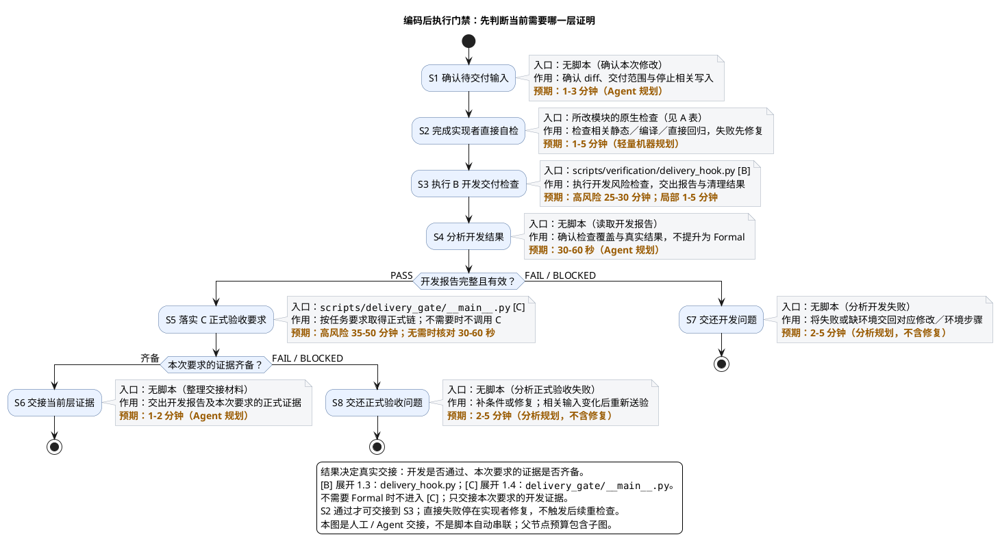
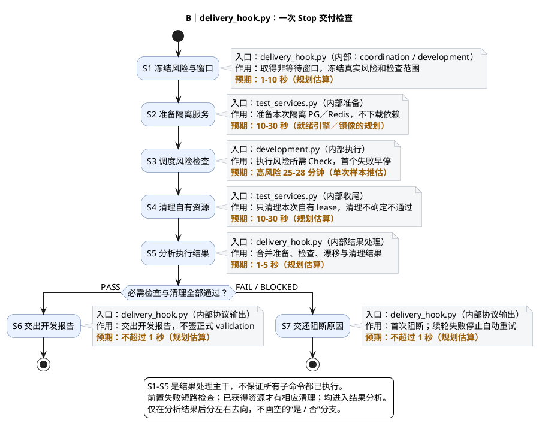
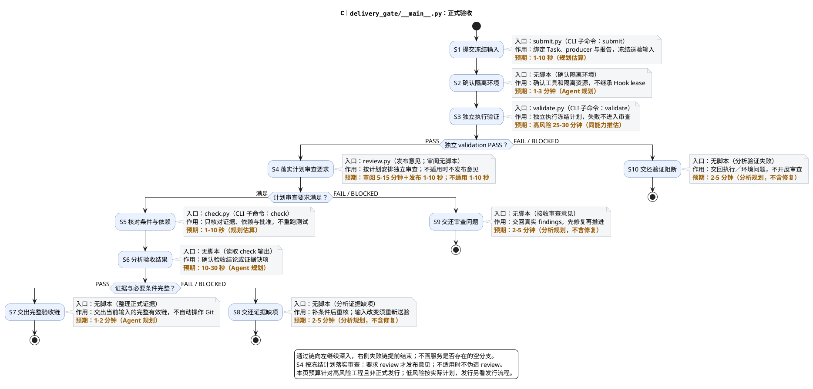

# 1. 场景：编码后执行仓库门禁

> 上级：[仓库生命周期](../overview.md)。前置：实现基本完成、修改范围清楚、相关输入停止写入。优化门禁是[另一项任务](optimize-repository-gates.md)。

**先直接自检，再取得开发报告；需要时继续正式验收。** 不要求每次都运行全部 Verify、Hook、CI 和发行检查。

## 1.1. 先看执行与交接

执行节点的三行注释固定为：入口（文件／无脚本）、作用、预期耗时。总图 S3 [B] 和 S5 [C] 分别展开到本页 1.3、1.4。



| 图中节点 | 核心作用 | 入口／说明 |
| --- | --- | --- |
| S2 [A] 直接自检 | 实现者先修相关错误 | 下方 A 表的原生检查 |
| S3 [B] 开发检查 | 取得风险所需开发报告 | [delivery_hook.py](../../../scripts/verification/delivery_hook.py) → 1.3 [B] |
| S5 [C] 正式验收 | 需要时取得独立验收链 | [delivery_gate/__main__.py](../../../scripts/delivery_gate/__main__.py) → 1.4 [C] |

其他节点是确认、读报告或交接材料，没有对应自动脚本。直接自检失败先修实现；开发报告失败不送正式验收；没有授权不操作 Git。

## 1.2. A／B／C 的区别与 A 的入口

| 层次 | 证明范围 | 执行边界 |
| --- | --- | --- |
| A：直接自检 | 本次实现的相关静态／编译／定点测试 | 实现者执行；不代替完整开发报告或正式验收 |
| B：开发检查 | 真实 diff 与风险所需完整检查闭包 | 工作包安排未参与实现的执行者；Hook 只产开发报告，不签 Formal 身份收据 |
| C：正式验收 | 冻结 Task／输入／计划的独立执行及适用审查 | validator 与 producer／submitter 分离；reviewer 再分离；review／check 不重跑测试 |

身份与分工以 [agent-policy](../../../harness/agent-policy.manifest.yaml) 为准；开发报告不能直接升级为 Formal validation。

| A：改动类型 | 直接检查 | 入口文件／说明 |
| --- | --- | --- |
| Python 工具 | `python3 -m scripts.repository.python_quality`；相关 `python3 -m unittest <测试模块>` | [python_quality.py](../../../scripts/repository/python_quality.py)、对应[直接测试](../../../tests/) |
| Java 产品 | 经 `java_exec` 运行相关 Gradle 静态／编译／测试任务 | [java_exec.py](../../../scripts/environment/java_exec.py)、[原生任务](../reference/java-checks.md) |
| 扩展 | `npm --prefix extension run build`；相关 `node --test` | [package.json](../../../extension/package.json)、[直接测试](../../../extension/tests/) |
| 文档 | `python3 -m scripts.repository.docs_check` | [docs_check.py](../../../scripts/repository/docs_check.py) |

按修改选择，不把所有语言检查都跑一遍。

## 1.3. 展开 B：Stop 交付检查怎样执行

**对应总图 S3 [B]。** 公开入口：[delivery_hook.py](../../../scripts/verification/delivery_hook.py)::`main()`，接收客户端 Stop 输入；手工调用方式见 [Hook 说明](../change-delivery/hooks.md)。

图中其余文件是内部实现，不是需要依次手动运行的脚本。



| 节点 | 核心作用 | 实现文件 |
| --- | --- | --- |
| S1 窗口与冻结 | 固定当前风险和检查范围；忙时 BLOCKED | [coordination.py](../../../scripts/verification/coordination.py)、[development.py](../../../scripts/verification/development.py) |
| S2／S4 准备与清理 | 只使用、清理本次隔离资源 | [test_services.py](../../../scripts/environment/test_services.py) |
| S3 检查执行 | 执行所需 Check；首个失败早停 | [development.py](../../../scripts/verification/development.py)、[检查声明](../../../harness/module-checks.yaml) |
| S5 结果分析 | 合并检查、漂移与清理结果 | [delivery_hook.py](../../../scripts/verification/delivery_hook.py) |
| S6／S7 协议输出 | 交报告或阻断；续轮失败 `continue=false` | [delivery_hook.py](../../../scripts/verification/delivery_hook.py)、[Stop 策略](../../../harness/delivery-hooks.json) |

准备失败不执行检查；清理不确定不能 PASS。无 diff 或中间回合也不签 PASS。每个 Check 的内部命令与耗时见[共用检查链](../change-delivery/verification.md)。

显式开发入口是 [development.py](../../../scripts/verification/development.py)::`main()`，不自动创建服务。按[隔离环境说明](../operations/verification-environment.md)准备后运行：

```sh
.local/lexiflow-python/bin/python -m scripts.verification.development
```

显式 CLI 与正常 Stop 不会自动跨调用去重，普通交付不能绕过 Stop。完整 Verify／diagnose／quick CI 按目的另选，入口见[Verify](../change-delivery/verification.md)与[CI](../operations/github-actions.md)。

## 1.4. 展开 C：正式验证、审查与条件核对

**对应总图 S5 [C]。** CLI 入口：[delivery_gate/__main__.py](../../../scripts/delivery_gate/__main__.py)::`main()`；命令为 `python3 -m scripts.delivery_gate <子命令> ...`，参数见 [Delivery Gate](../change-delivery/delivery-gate.md)。

`submit.py`、`validate.py`、`review.py`、`check.py` 是独立职责的实现文件，不是各自可直接运行的 CLI。各阶段由不同职责的执行者交接，不是一个 actor 连续自签。



| 节点／子命令 | 核心作用 | 实现文件 |
| --- | --- | --- |
| S1 `submit` | 冻结真实 Task、来源报告与送验输入 | [submit.py](../../../scripts/delivery_gate/submit.py) |
| S3 `validate` | 独立执行冻结计划并发布验证证据 | [validate.py](../../../scripts/delivery_gate/validate.py) |
| S4 `review` | 只发布独立审阅形成的真实意见；不适用不发布 | [review.py](../../../scripts/delivery_gate/review.py) |
| S5 `check` | 核对证据、依赖与必要批准，不重跑测试 | [check.py](../../../scripts/delivery_gate/check.py) |

S2 环境确认、S6 读结果、S7–S10 交接或分析均没有统一自动脚本。缺条件可补齐后重核；相关输入改变须重新送验；已清理的 Hook lease 不能传给 validate。

## 1.5. 预算依据与维护位置

预算前提：工具、浏览器依赖、引擎与镜像已就绪，无相关并发写入。安装、下载、用户响应和排期另计。

| 预算 | 依据 |
| --- | --- |
| B：高风险 25–30 分钟 | 同批完整成功报告 `00fd7d32-8132-4bc1-adca-9a104e804f58`、`3ebc011b-a56b-4317-bf5e-97a2530d1c10`：物理 Check 1508.127 秒，窗口 1510.083 秒，约 25 分 10 秒；仅一个样本 |
| A／B：轻量 1–5 分钟 | 规划估算；依赖纳入昂贵模块时重新估计，不是局部风险的固定时长 |
| C：高风险非发行 35–50 分钟 | 相近计划的 validation 推估 25–30 分钟，另含主动准备、审阅与交接；不是 Formal 实测，发行另估 |
| 秒级处理与 Agent 工作 | 均为规划预算；父阶段包含子图，不重复相加；两次独立执行分别计时 |

预期不是 SLA、timeout 或 PASS 条件，也不证明优化收益。执行步骤只在本页完整维护；改进任务见[优化场景](optimize-repository-gates.md)，字段与参数见各能力页，未决设计见[问题台账](../../roadmap/master-plan/phase2/status.md)。返回[总入口](../overview.md)。
