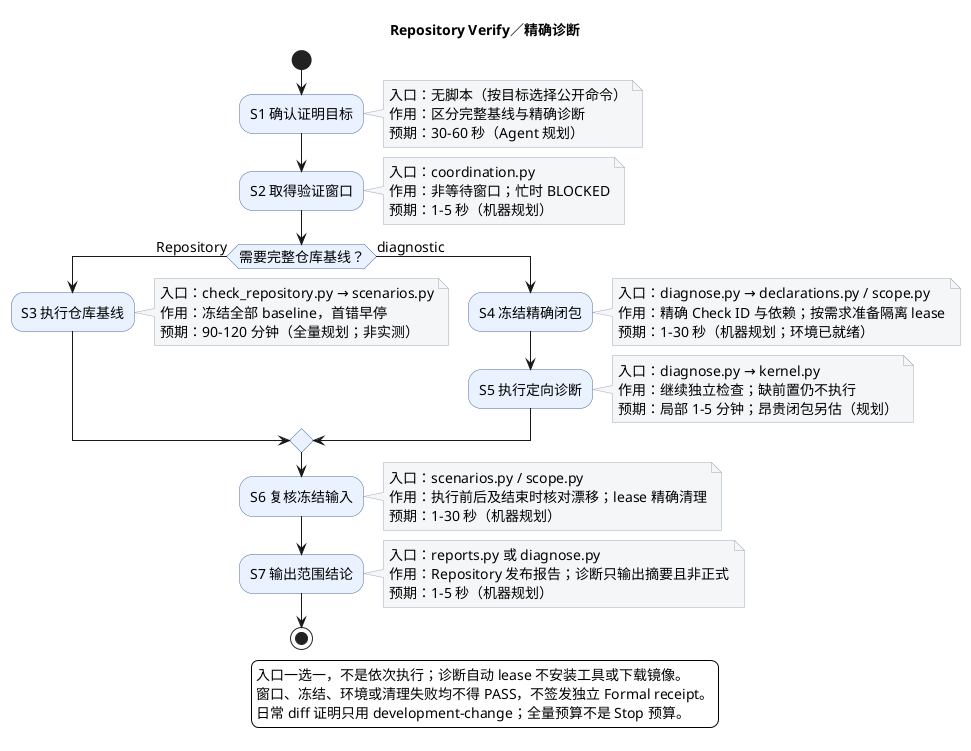

# 1. Verify：选择、执行与报告

> 位置：[工程地图](../README.md) → [检查能力](checks.md) → Verify。输入是当前源码与检查声明；输出是 verification report，不是正式 receipt。

## 1.1. 按证明目标选唯一入口

日常编码步骤见[执行门禁场景](../scenarios/run-repository-gates.md)。开发报告、完整仓库基线和精确诊断不是要求依次叠跑的三道门禁。



| 目标 | 公开入口 | 证明边界 |
| --- | --- | --- |
| 绑定完整真实 diff 的开发反馈 | `python3 -m scripts.verification.commands.run_development_checks`，或正常客户端 Stop | 一个 frozen `development-change` profile、一个不可变 report；不是独立 Formal |
| 显式完整仓库基线 | `python3 scripts/verification/commands/run_repository_checks.py` | 完整 `repository-baseline`；缺环境或未执行不能 PASS |
| 定位精确 Check 问题 | `python3 -m scripts.verification.commands.diagnose_repository_check --check-id <canonical-check-id>` | 自动执行该 ID 的依赖闭包和所需隔离服务 lease；输出诊断摘要，不发布完整报告或 Formal 资格 |

开发入口不接收 root、base、check ID 或风险覆盖参数。比较基点固定取可解析的 `merge-base HEAD @{upstream}`，无法确定时回退 `HEAD`；输入包含基点之后的已提交、tracked 工作区差异和非忽略 untracked 文件。同工作区其他变化不能由调用者排除。

检查选择来自每个变化消费输入的 canonical triggers 与模块依赖闭包。高风险不单独追加全仓 `development-baseline`；风险分类、未知覆盖、依赖环与漂移失败关闭仍保留。无开发 diff 不产生开发 PASS。需要完整仓库证明时显式使用 Repository 入口，不再提供另一种 Change diff 报告入口。

独立 Formal 高风险计划使用 `development-baseline` 并要求 review；正式发行计划使用完整 `repository-baseline` 并要求 review。发行资格由 Task 必需 Check 命中 Registry `scenario_policy.ci_quick.formal_only_check_ids` 派生，不从 Task 名称或普通 CI 绿灯推断。发行以固定 handoff 送验干净提交和候选，不要求开发 diff；完整发行基线由独立 validator 执行，Actions 不提前重复运行。详见 [Delivery Gate](delivery-gate.md)。

### 1.1.1. 实现者直接自检与精确诊断

先按实际修改做静态、编译和直接回归，不惯例性叠跑完整 adapter、development 和 Stop。实现者不能自签 validation/review。精准诊断示例：

```bash
.local/lexiflow-python/bin/python -m scripts.verification.commands.diagnose_repository_check --check-id eng.backend.delivery
.local/lexiflow-python/bin/python -m scripts.verification.commands.diagnose_repository_check --check-id eng.extension.quality
```

声明依赖会同时执行，扩展 Check 不是仅前端单测。诊断自动派生服务需求并管理 lease，但不安装工具、下载镜像或启动引擎；缺环境 BLOCKED。只有已明确隔离的资源可以用于原生 Gradle 或显式 CLI，见[验证环境](../scenarios/verification-environment.md)。功能开发不等待公开发行或真实资料分发验收。

### 1.1.2. Docker 日常闭包

日常按消费依赖选择固定 `surface`、`shell`、`local`、`node` 组；成员和触发唯一归 [module-checks.yaml](../../config/engineering/module-checks.yaml)，执行归 [run_deployment_contract_tests.py](../../scripts/checks/deployment/run_deployment_contract_tests.py)。例如只改合同 fixture 选 surface，改实际 command 可能同时选择 surface/local/node；普通业务 Java 不因此全跑 Docker 合同，但 SQL、RuntimeHealth 等实际消费输入仍触发。

完整 `eng.release.docker-contract` 在 Repository baseline、相关 Formal 与 quick CI 保留全套检查；日常全选四组不再叠加完整项。覆盖、无跳过和失败关闭不因分组削弱。

## 1.2. Canonical Check 与场景

Registry 为 `lexiflow.module-checks.v5`。每个稳定 `check_id` 直接拥有命令 argv、输入、环境与超时，不另设执行 ID、`module` 展示名称或关联层。纯输入目录递归冻结实际源码集合，排除构建产物但拒绝显式声明产物路径；四组 Docker 测试仍保存精确且不重叠的执行成员。`scenarios` 仅声明非空资格列表，例如 `[repository-baseline, change-targeted]`，不提供场景内 trigger override 或 fallback。唯一 `triggers` 用于开发与 CI 的变更路径选择；完整基线按资格执行所有项目。仅基线具备资格的 Docker contract 仍由 CI 读取其唯一 triggers，不因资格不同再维护场景覆盖。依赖使用稳定 Check ID，无依赖时不填写 `module_dependencies`；非空依赖仍核对身份、重复、循环和前置结果。不保留旧格式或别名。

能力身份和场景成员不是同一集合，不能合并不同 scene 的选择差异；实际成员与数量由 Registry 派生，不在说明页维护另一份计数。quick 常驻与 formal-only 集合也只来自同一 Registry 的 `scenario_policy.ci_quick`。

选择后按依赖优先执行；交付首个 FAIL/BLOCKED 早停，其余记 BLOCKED，不用其他 PASS 抵消。诊断可继续独立检查，但缺前置仍不执行。精确入口、职责及预算参考见[共用 Check 清单](verification/check-catalog.md)，该清单不是全部必跑计划。

## 1.3. 执行、环境与新鲜度

同 checkout 使用非等待验证窗口；忙时 BLOCKED，不锁编辑、不终止未知进程、不删锁。声明源码通过不跟随链接的目录描述符读取，快照绑定路径、字节 hash、大小与执行位；不安全输入和读取竞态拒绝。选择、执行前后与报告发布均核对闭包，相关 drift 不能 PASS。

执行固定使用 `kernel.run_check_process`，子进程只消费固定 run/check/snapshot 并从声明重派生后精确比对；scope 资格由父端证明。progress observer 只接收脱敏事件，不读 env/stdin/raw stdout、不返回 process result、不决定 PASS。取消、异常、预算耗尽仍回收当前自有进程与资源。

环境唯一使用 `resolve_check_environment`：`.values` 私有执行，`.diagnostic` 可公开。实际解释器、PATH 解析工具、真实路径与内容摘要，以及 PyYAML/锁/摘要工具能力均认证；不只比较 PATH 字符串。Apple Git 绑定实际 payload，不用 prepared wrapper。报告消费时重新解析，不跨事务缓存资格，不序列化私有环境值。

Formal `verify_profiles` 及同次 1..16 Task batch 保留。在输入、配置、环境、window、runner、context 和 result contract 完整等价且显式允许时可复用同次 Check；未知副作用、失败、runtime transport 和历史结果不可复用，开发自检不能投影成 Formal。台账仅在本次调用真实窗口内，结束即失效。

## 1.4. 文件定位与结果交接

| 职责 | 文件 |
| --- | --- |
| 开发与完整仓库入口 | [run_development_checks.py](../../scripts/verification/commands/run_development_checks.py)、[run_repository_checks.py](../../scripts/verification/commands/run_repository_checks.py) |
| 声明、选择与冻结 | [check_definitions.py](../../scripts/verification/planning/check_definitions.py)、[check_scope_selection.py](../../scripts/verification/planning/check_scope_selection.py)、[source_file_snapshot.py](../../scripts/verification/planning/source_file_snapshot.py) |
| 编排与执行 | [check_plan_runner.py](../../scripts/verification/execution/check_plan_runner.py)、[check_runner.py](../../scripts/verification/execution/check_runner.py)、[Environment API](../../scripts/environment/__init__.py) |
| 报告与诊断 | [verification_report_store.py](../../scripts/verification/reports/verification_report_store.py)、[diagnose_repository_check.py](../../scripts/verification/commands/diagnose_repository_check.py)、[verification_report_summary.py](../../scripts/verification/reports/verification_report_summary.py) |

报告位于 ignored `tmp/quality/verification-reports/`；public API 读取会重核当前来源和附件，不信任手写 PASS JSON。`PASS` 只证明冻结范围，缺环境为 `BLOCKED`，断言或输入冲突为 `FAIL`。skip、未执行、零测试和缺结果均不能 PASS。详细失败层定位见[排障](troubleshooting.md)。

backend 保留 Gradle deliveryFull 的全部质量、架构与业务检查；scripts 的 Python 质量入口自身执行 Ruff check、Ruff format、Pylint 中文 docstring 三项和所选模块测试。机器 adapter 必须输出结构化 zero-exit JSON transport，不能用人工 CLI 退出零代替结果。规则见 [python-quality.toml](../../config/engineering/python-quality.toml)，固定中文 docstring 规则见 [check_python_quality.py](../../scripts/checks/repository/python/check_python_quality.py)。Stop 触发与恢复见[Hook](hooks.md)。需要正式验收时将唯一开发报告交给 [submit](delivery-gate.md)。
