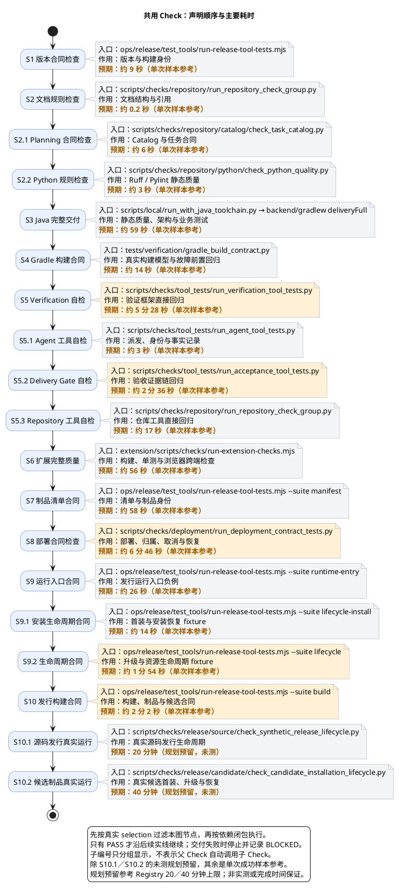

# 1. 共用 Check 清单

> 位置：[Verify](../verification.md) → 共用 Check。此清单解释单项实现入口、作用与样本预算；实际触发、范围、依赖、输入、环境及结果合同以 [module-checks.yaml](../../../config/engineering/module-checks.yaml) 为准。它不是要求每次运行全部节点的顺序清单。

## 1.1. 执行链与节点

日常开发、完整 Verify、Formal validation 和 CI 复用同一检查能力，但选择范围、冻结输入和身份结论不同。先由真实 `selection` 过滤节点，再按依赖闭包执行；子编号只分组显示，不代表父 Check 自动调用子 Check。

时间来自本机 Apple Silicon、项目 Python／Java 25 环境中的一个完整成功开发批次（两个冻结开发检查范围；报告 ID `00fd7d32-8132-4bc1-adca-9a104e804f58`、`3ebc011b-a56b-4317-bf5e-97a2530d1c10`）。它们是单次参考，不是稳定区间、CI 预期或本次输入的验收；环境准备、下载、人工等待另计。淡橙只强调分钟级耗时，不表示 FAIL。

图与表列出实现文件、作用及预期参考；公开执行命令以表为准，内部实现文件不是要求额外运行的 CLI。S10.1／S10.2 尚无完整成功实测，各预留 20／40 分钟，参考 Registry 单项上限；这是规划预算，不保证实际可在预算内完成。其他节点使用单次样本参考；真正的触发路径、依赖、输入、环境和结果合同仍由 [module-checks.yaml](../../../config/engineering/module-checks.yaml) 维护，表格不定义第二套规则。

| 节点 | 核心作用 | 入口链接／样本 |
| --- | --- | --- |
| S1 | 版本与身份合同 | `node ops/release/test_tools/run-release-tool-tests.mjs`；[run-release-tool-tests.mjs](../../../ops/release/test_tools/run-release-tool-tests.mjs)；单次约 9 秒 |
| S2 | 文档结构、链接与规则 | `python3 -m scripts.checks.repository.run_repository_check_group --mode docs`；入口 [quality.py](../../../scripts/checks/repository/run_repository_check_group.py)；样本约 0.2 秒 |
| S2.1 | Catalog 合同 | `python3 -m scripts.checks.repository.run_repository_check_group --mode planning`；入口 [quality.py](../../../scripts/checks/repository/run_repository_check_group.py)；样本约 6 秒 |
| S2.2 | scripts 静态质量 | `python3 -m scripts.checks.repository.run_repository_check_group --mode python`；入口 [quality.py](../../../scripts/checks/repository/run_repository_check_group.py)；样本约 3 秒 |
| S3 | Java 完整模块检查 | [scripts/local/run_with_java_toolchain.py](../../../scripts/local/run_with_java_toolchain.py) → `backend/gradlew deliveryFull`；[Java 检查](../java-checks.md)；单次约 59 秒（含聚合子任务） |
| S4 | 构建模型与前置故障回归 | [tests/verification/gradle_build_contract.py](../../../tests/verification/gradle_build_contract.py)；单次约 14 秒 |
| S5 | 验证器自身回归 | [scripts/checks/tool_tests/run_verification_tool_tests.py](../../../scripts/checks/tool_tests/run_verification_tool_tests.py)；单次约 5 分 28 秒 |
| S5.1 | 派发／身份／结果合同 | [scripts/checks/tool_tests/run_agent_tool_tests.py](../../../scripts/checks/tool_tests/run_agent_tool_tests.py)；单次约 3 秒 |
| S5.2 | 验收证据链回归 | [scripts/checks/tool_tests/run_acceptance_tool_tests.py](../../../scripts/checks/tool_tests/run_acceptance_tool_tests.py)；单次约 2 分 36 秒 |
| S5.3 | 仓库工具回归 | `python3 -m scripts.checks.repository.run_repository_check_group --mode tests`；入口 [quality.py](../../../scripts/checks/repository/run_repository_check_group.py)；样本约 17 秒 |
| S6 | 构建、单测、真实跨端检查 | `node extension/scripts/checks/run-extension-checks.mjs`；单次约 56 秒（含子步骤） |
| S7 | 清单与制品身份 | `node ops/release/test_tools/run-release-tool-tests.mjs --suite manifest`；单次约 58 秒 |
| S8 | 部署、取消、归属与恢复回归 | [scripts/checks/deployment/run_deployment_contract_tests.py](../../../scripts/checks/deployment/run_deployment_contract_tests.py)；单次约 6 分 46 秒（含 Python／Node 套件） |
| S9 | 运行入口负例 | `node ops/release/test_tools/run-release-tool-tests.mjs --suite runtime-entry`；单次约 26 秒 |
| S9.1 | 首装 fixture | `node ops/release/test_tools/run-release-tool-tests.mjs --suite lifecycle-install`；单次约 14 秒 |
| S9.2 | 升级／资源 fixture | `node ops/release/test_tools/run-release-tool-tests.mjs --suite lifecycle`；单次约 1 分 54 秒 |
| S10 | 构建、制品与候选 fixture | `node ops/release/test_tools/run-release-tool-tests.mjs --suite build`；单次约 2 分 2 秒（非发行总时间） |
| S10.1 | 真实源码发行生命周期 | [scripts/checks/release/source/check_synthetic_release_lifecycle.py](../../../scripts/checks/release/source/check_synthetic_release_lifecycle.py)；Formal only，预留 20 分钟（规划，未测） |
| S10.2 | 真实候选首装、升级、恢复 | [scripts/checks/release/candidate/check_candidate_installation_lifecycle.py](../../../scripts/checks/release/candidate/check_candidate_installation_lifecycle.py)；Formal only，预留 40 分钟（规划，未测） |

## 1.2. 预算与边界

计算一次交付等待时间，以实际物理执行及窗口为准；同事务复用不再次累加，父入口与子节点不相加，不跨交付复用旧 PASS。声明或实现变化后须重新判断样本适用性，节点样本总和不代表所有场景的预计完成时间。

能力身份由 Registry canonical ID 唯一维护，图只展示选后执行能力；24 个 canonical checks 在 repository-baseline／change-targeted 分别有 20／23 个成员。移除 Git 提醒检查不影响客户端 Stop；本页样本不能替代最新输入执行。
