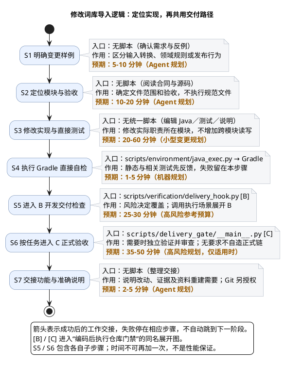

# 1. 场景：修改词库导入逻辑

> 上级：[仓库生命周期](../README.md)。这是修改功能的任务；仅运行现有导入命令请去[导入操作](lexicon-import.md)，不是先优化门禁。

**先定位规则所在模块，再修改和验证。** 输入是需求样例与现行合同，输出是实现、直接回归结果和适用的交付证据；本场景不要求对开发库实际重建或全量重导。

## 1.1. 从需求到交接



图展示各步骤成功后的交接。S5 [B]、S6 [C] 的入口和分支均在[执行门禁场景](run-repository-gates.md)维护，不在功能页重复。预算按小型 Java 变更与高风险路径规划；实际风险取决于 diff，B／C 的样本依据见执行页。

| 节点 | 核心作用 | 文件／深入入口 |
| --- | --- | --- |
| S1 | 把目标写成输入样例、输出断言和反例 | [词库合同](../system/lexicon.md)、[记录处理](lexicon-import/record-processing.md) |
| S2 | 确定转换、领域、存储或命令职责，以及不改什么 | 下方 1.2 模块定位；[当前规范](../../openspec/specs/product-architecture/spec.md) |
| S3 | 修改所在模块与相应测试，更新唯一正文 | [Lexicon](../../backend/product/lexicon/src)、[Adapters](../../backend/product/adapters/src) |
| S4 | 静态／编译／直接回归先修错 | [java_exec.py](../../scripts/environment/java_exec.py)、[Gradle 任务](../reference/java-checks.md) |
| S5 [B] | 取得风险要求的开发报告 | [delivery_hook.py](../../scripts/verification/delivery_hook.py) → [执行页 B](run-repository-gates.md) |
| S6 [C] | Task 要求时取得独立正式验收链 | [delivery_gate/__main__.py](../../scripts/delivery_gate/__main__.py) → [执行页 C](run-repository-gates.md) |
| S7 | 交出 diff、证据、使用说明与数据处理边界 | [导入操作](lexicon-import.md)；Git 另按 [AGENTS.md](../../AGENTS.md)授权 |

## 1.2. 按实际变化定位模块

| 要修改的行为 | 实现位置 | 直接测试位置 |
| --- | --- | --- |
| StarDict 行读取与转换 | [StardictCsvReader.java](../../backend/product/adapters/src/main/java/io/lexiflow/lexicon/platform/importer/StardictCsvReader.java) | [StardictCsvReaderTest.java](../../backend/product/adapters/src/test/java/io/lexiflow/lexicon/platform/importer/StardictCsvReaderTest.java) |
| 导入计划、预检与领域发布 | [application/importing](../../backend/product/lexicon/src/main/java/io/lexiflow/lexicon/application/importing) | [importing 测试](../../backend/product/lexicon/src/test/java/io/lexiflow/lexicon/application/importing) |
| CLI 及人工确认／重建 | [LexiconImportMain.java](../../backend/product/adapters/src/main/java/io/lexiflow/lexicon/platform/importer/LexiconImportMain.java)、[LexiconRebuildMain.java](../../backend/product/adapters/src/main/java/io/lexiflow/lexicon/platform/importer/LexiconRebuildMain.java) | [importer 测试](../../backend/product/adapters/src/test/java/io/lexiflow/lexicon/platform/importer) |
| 数据库字段、约束与事务 | [persistence](../../backend/product/adapters/src/main/java/io/lexiflow/lexicon/platform/persistence)、[schema.sql](../../infra/postgres/schema.sql) | [Adapters 测试](../../backend/product/adapters/src/test) |

S2 的“范围与验收”是定义任务，不是运行 Harness/OpenSpec，不是冻结这两个目录。修改结构时，重建重导的安全边界引用[数据模型](../system/lexicon/data-model.md)和[导入操作](lexicon-import.md)，不能用修改文档代替实际资料更新。

## 1.3. 直接自检与失败回去的位置

先按实际改动选 Gradle project 和测试类，例如转换行为的直接回归：

```bash
python3 -m scripts.environment.java_exec backend/gradlew -p backend :adapters:test --tests io.lexiflow.lexicon.platform.importer.StardictCsvReaderTest
```

静态任务与完整聚合的区别见[Java 检查](../reference/java-checks.md)。S4 是实现者快速反馈；B 是风险覆盖；C 是独立验收，不能互相冒充。直接测试失败回到实现，B／C 失败按[执行页](run-repository-gates.md)交接，不机械追加全部套件。

不为验证功能改动而擅自导入真实资料、删除数据库、运行重建确认管道或发布制品。现行授权边界见 [Harness](../../harness/README.md)。
