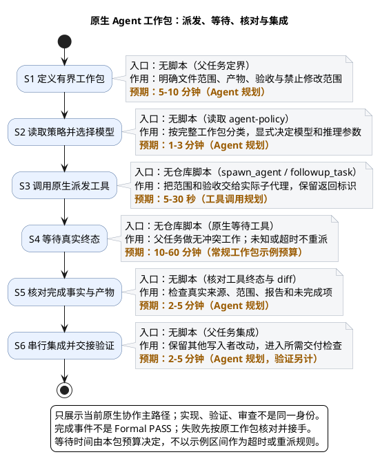

# 1. Agent workflow：有界派发与真实交接

> 上级：[仓库生命周期](../README.md)。Agent 协作是实现或独立验证的组织方式，不是额外交付阶段；先明确工作包，再决定是否需要委派。

**新派发使用原生 Codex 协作。** 策略真源为 [agent-policy](../../harness/agent-policy.manifest.yaml) 的 `subagent_protocol`、`codex_model_policy`、`agent_dispatch` 与 `qoder_delegation`；本页只解释实际交接。

## 1.1. 先看派发到集成

| 节点 | 核心作用 | 入口／交接产物 |
| --- | --- | --- |
| S1 | 明确可独立验收的职责、文件范围与禁止范围 | [Task / Catalog](../../planning/workstreams.yaml)；无关计划漂移不冒充通用派发锁 |
| S2 | 每次调用前读取完整工作包的模型策略 | [agent-policy](../../harness/agent-policy.manifest.yaml)；显式模型与 reasoning 参数 |
| S3 | 调用 `spawn_agent`／`followup_task`，展示真实交接 | 原生协作工具；返回的真实 agent 标识 |
| S4 | 等待终态，做无写域冲突的其他工作 | 原生事件／等待工具；未知状态不当成失败重派 |
| S5 | 核对来源、范围、产物和阻塞项 | 真实工具终态、diff、报告；规范记录另用[Codex 核对入口](../../scripts/agents/delegation/codex_cli.py) |
| S6 | 串行集成，交给所需验证／审查 | [执行门禁场景](run-repository-gates.md)；完成信号不是验收 receipt |

本图的等待预算仅示例，不替代策略或具体工作包预算。图中协作工具不由仓库脚本实现，不能虚构一个脚本路径。

## 1.2. 派发前后交接什么

原生 Codex 工作包给出精确有序的 Task IDs、对应 Task/change versions、目标、允许／禁止路径、必要上下文、逐 Task 产物与验收和直接检查；字段及当前 Catalog 对账要求见 [subagent_protocol](../../harness/agent-policy.manifest.yaml)。派发前在当前聊天说明范围与模型选择依据；派发后保留真实 agent 标识。并行写入范围不得重合，不覆盖其他线程修改；真实身份与并发合同见 [Harness](../../harness/README.md)。

模型按工作包选择，角色名或提示词不能代替工具参数。升级条件、等待与接手预算只在 policy 维护，不在文档缓存一份阈值。planning-only 计划不是已具备派发资格的 Task。

## 1.3. 完成后怎样交给验证

核对终态不只看 exit-zero：确认当前输入、实际 diff、产物 locator、真实身份与未完成项。实现者可做静态、编译和直接回归；完整交付检查与正式 validation 按[执行场景](run-repository-gates.md)进行。`INDEPENDENT_REVIEW` 只读冻结证据，`CATALOG_DECISION` 只核对证据链，两层不重跑命令。

直接检查、开发 Hook、正式验收的复用边界见 [policy validation_efficiency](../../harness/agent-policy.manifest.yaml)。不要惯例叠跑完整 adapter、development 和 Hook；更不能把实现者报告导入为正式独立验证。

原始记录及身份来源见[身份与运行事实](delegate-work/identity.md)。核对结果与正式验收分开，失败按原工作包接手，不改 Task 身份重置预算。

## 1.4. 既有 Qoder 记录怎样处理

Qoder 新 `start`／`resume` 已禁用；其 `status`、`result`、`validate-result` 和 `ack` 仅供既有运行核对。匹配原父 Session 与真实 run 的终态 callback 后，核对原始事实再 ack；重复已消费信号不再派发。未知占用、观察超时不授权重派，也不改写旧记录。

Qoder 客户端 Stop 配置仍存在，见 [Hook](../reference/hooks.md)。这是客户端触发器，不表示 Qoder agent 可重新启动。

## 1.5. 原生验收与新任务例外

验证／审查使用当前父任务下不同的真实原生子代理，不伪造 actor；共享宿主 Session 不等于同一执行者。内部协作不使用 `create_thread`。

确需新任务例外时，先按 policy 收集当前输入的多轮独立验证、Hook 阻塞与定向修复证据，说明能力边界并取得用户明确授权；缺环境、身份报错、业务失败或未知运行不能单独构成理由。例外仍遵守原检查要求，不能绕过 Hook。

失败定位回到[排障](../reference/troubleshooting.md)；文件维护查 [Scripts](../reference/scripts.md)。
