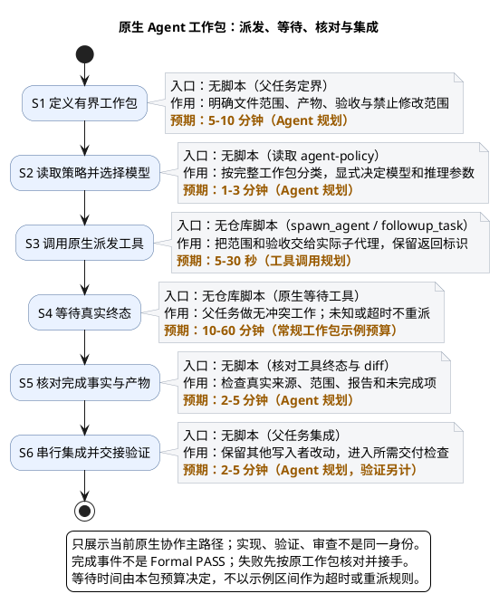

# 1. Agent workflow：有界派发与真实交接

> 上级：[仓库生命周期](../README.md)。Agent 协作是实现或独立验证的组织方式，不是额外交付阶段；先明确工作包，再决定是否需要委派。

**新派发使用当前运行时支持的原生 Agent 协作。** 当前已实现的原生适配器为 Codex；共享身份与目标合同不依赖客户端名称。策略真源为 [agent-policy](../../harness/agent-policy.md) 的相关协作规则与 `codex_model_policy`；本页只解释实际交接。

## 1.1. 先看派发到集成

| 节点 | 核心作用 | 入口／交接产物 |
| --- | --- | --- |
| S1 | 明确可独立验收的职责、文件范围与禁止范围 | [Task / Catalog](../../planning/workstreams.yaml)；无关计划漂移不冒充通用派发锁 |
| S2 | 每次调用前读取完整工作包的模型策略 | [agent-policy](../../harness/agent-policy.md)；显式模型与 reasoning 参数 |
| S3 | 调用 `spawn_agent`／`followup_task`，展示真实交接 | 原生协作工具；返回的真实 agent 标识 |
| S4 | 等待终态，做无写域冲突的其他工作 | 原生事件／等待工具；未知状态不当成失败重派 |
| S5 | 核对来源、范围、产物和阻塞项 | 真实工具终态、diff、报告；规范记录另用[Codex 核对入口](../../scripts/agents/work_packages/verify_codex_work_package.py) |
| S6 | 串行集成，交给所需验证／审查 | [执行门禁场景](run-repository-gates.md)；完成信号不是验收 receipt |

本图的等待预算仅示例，不替代策略或具体工作包预算。图中协作工具不由仓库脚本实现，不能虚构一个脚本路径。

## 1.2. 派发前后交接什么

原生工作包先定义有序 Task、版本、目标、范围与验收，再由包级入口 `scripts.agents.identity.codex_actor_identity.bind_work_package(repo_root, caller_contract)` 认证来源并冻结合同。字段与 Catalog 对账由 [工作包实现](../../scripts/agents/work_packages/codex_work_package_publisher.py)定义；[协作规则](../../harness/agent-policy.md)维护人工责任。交接保留精确 run ID、原生 agent 标识与真实产物，调用者不能注入身份，也不能扩大范围或覆盖他人修改。

模型按工作包选择，角色名或提示词不能代替工具参数。升级条件、等待与接手预算只在 policy 维护，不在文档缓存一份阈值。planning-only 计划不是已具备派发资格的 Task。

## 1.3. 完成后怎样交给验证

完成时 `CodexWorkPackagePublisher(root).publish(run_id, outcomes)` 只接收 run locator 与精确 Task outcome map：每 Task 只发布 projection/outcome，唯一 package-completion 最后发布，原生 compact signal 不落重复镜像。核对用 `verify(run_id)` 重新认证来源、检查 Catalog drift 并派生 producer_view，不由当前 Catalog 填补冻结字段。

核对终态不只看 exit-zero：确认当前输入、实际 diff、产物 locator、真实身份与未完成项。实现者可做静态、编译和直接回归；完整交付检查与正式 validation 按[执行场景](run-repository-gates.md)进行。`INDEPENDENT_REVIEW` 只读冻结证据，`CATALOG_DECISION` 只核对证据链，两层不重跑命令。

直接检查、开发 Hook、正式验收的复用边界见 [冻结、验证与独立性](../../harness/agent-policy.md)。不要惯例叠跑完整 adapter、development 和 Hook；更不能把实现者报告导入为正式独立验证。

[codex_actor_identity.py](../../scripts/agents/identity/codex_actor_identity.py) 从原生 thread 及父任务元数据识别稳定 actor，[codex_identity_binding.py](../../scripts/agents/identity/codex_identity_binding.py) 认证来源。actor、Session 和 run 不由调用者自报；共享宿主 Session 允许不同原生 actor，环境变量只定位元数据。这里是可信本机用户边界，不是平台密码学证明。执行模块不导入 Delivery Gate，也不签发 validation/review。

原始工作包保存在 ignored `tmp/quality/codex-work-packages/<run-id>/`。核对结果与正式验收分开，失败按原工作包接手，不改 Task 身份重置预算。手工客户端 Stop 见 [Hook](../reference/hooks.md)。

## 1.4. 原生独立验收

验证／审查使用当前父任务下不同的真实原生子代理，不伪造 actor；共享宿主 Session 不等于同一执行者。内部协作不使用 `create_thread`，不保留新聊天兜底例外。

多 checkout 的执行以实际目标仓库为准，不以聊天所属项目或启动目录代替。先核对入口所属代码和 `repository_root`，再在该目标创建或消费记录；身份、目标与精确提交／候选的责任见 [真实身份与回调](../../harness/agent-policy.md#真实身份与回调)。执行目标变化不是 actor 变化，不能用于绕过独立性检查。

失败定位回到[排障](../reference/troubleshooting.md)；文件维护查 [Scripts](../reference/scripts.md)。
