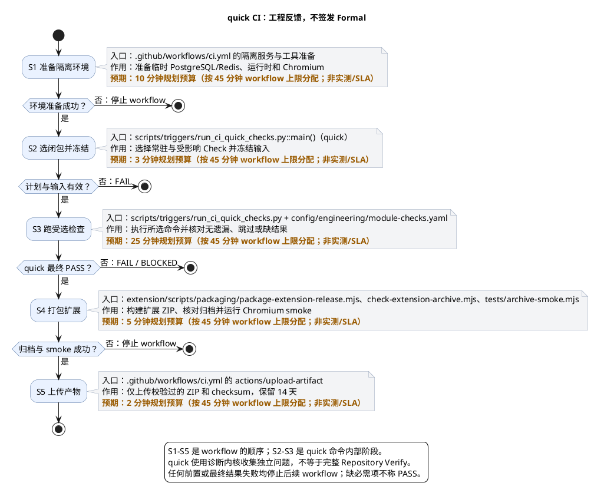
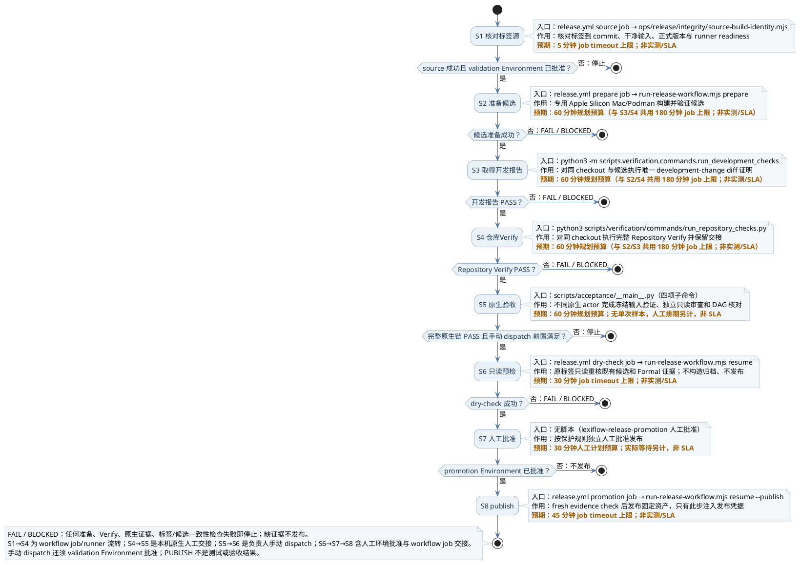

# 1. GitHub 检查与正式发行边界

> 位置：[仓库生命周期](../README.md) → GitHub Actions。普通工程反馈与正式发行是两层；任何快速检查都不是 Formal receipt。


首次在 GitHub 发布请从[第一次 Release 操作手册](github-actions/first-release.md)按顺序执行：先管理员配置与材料，后标签候选、原生验收和手动晋升。本页保留工作流模型与合同，不以流程图代替实际操作步骤。

## 1.1. 分支与 PR：共享快速入口

| 任务 | 命令或操作 | 成功判据 |
| --- | --- | --- |
| 检查 PR | `python3 -m scripts.triggers.run_ci_quick_checks quick --base <完整commit>`；新分支用 `--all` | 必需与受影响 Check 完成；不等于 full Verify/Formal |
| 下载并测试扩展包 | 从同次 quick run 下载 ZIP，校验 `.zip.sha256` 后加载解压目录 | artifact 对应目标 commit；Smoke 不替代真实观看或发行验收 |
| 准备正式候选 | 从受保护的 `v*` tag 触发 release workflow | 单一 Mac/Podman 候选与开发报告与完整 Repository Verify 完成 |
| 晋升公开发行 | 原标签手动续办，已有独立 Formal 链、两道人审授权与 `PUBLISH` | release资产摘要复核并发布；缺证/漂移立即停止 |

`.github/workflows/ci.yml` 在分支 push、`pull_request` 和手动运行时调用：

```sh
python3 -m scripts.triggers.run_ci_quick_checks quick --base <完整commit>
```

新分支没有可比较的前序 commit 时使用 `--all`；本机可用 `plan` 只查看选择，不执行检查。




图中主干箭头表示同一 workflow run 的顺序调用；quick 内部使用诊断内核收集独立问题，最终结果非 PASS 时停止后续 workflow，不把它描述为逐 Check 早停。`S4` 与 `S5` 是 Quick 成功后的同 run 扩展打包/上传步骤，不是 Quick 的独立验收。实际耗时随闭包、缓存及 CI 冷启动变化；图注提供 workflow 总预算分配，不是实测样本。

| 节点 | 命令 | 成功判据 |
| --- | --- | --- |
| S1 准备隔离环境 | `.github/workflows/ci.yml` 的 setup、`pip install`、`npm ci`、Playwright 安装 | Python/Java/Node 与合成 PostgreSQL/Redis/Chromium 就绪；缺项则 workflow 停止 |
| S2 选闭包并冻结 | `python3 -m scripts.triggers.run_ci_quick_checks quick --base <完整commit>` 或 `--all` | 常驻版本/docs，加上按变更触发的规划与受影响依赖闭包被选中；正式专属检查排除在 quick 外 |
| S3 执行受选检查 | `scripts/triggers/run_ci_quick_checks.py` 按 `config/engineering/module-checks.yaml` 执行声明命令 | 无必需 Check 被跳过或缺失；失败/缺环境时不得称 PASS |
| S4 打包扩展 | `node extension/scripts/packaging/package-extension-release.mjs`、`archive-check.mjs`、`archive-smoke.mjs` | 同次 run 的 ZIP 身份、checksum 与 Chromium smoke 匹配 |
| S5 上传产物 | GitHub `actions/upload-artifact` | 只上传 ZIP 和 checksum，14 天保留；非永久发行渠道 |

每节点时间只可作计划预算：S1 10 分钟、S2 3 分钟、S3 25 分钟、S4 5 分钟、S5 2 分钟；这是按 [`ci.yml`](../../.github/workflows/ci.yml) 的 45 分钟 workflow timeout 分配的规划预算，不是实测或 SLA。依赖冷启动、受影响检查、网络及人工下载另计；workflow 超时不能证明该预算充足。入口与边界分别见 [`ci.yml`](../../.github/workflows/ci.yml)、[`module-checks.yaml`](../../config/engineering/module-checks.yaml)、[`run_ci_quick_checks.py`](../../scripts/triggers/run_ci_quick_checks.py)。

检查仍由 `config/engineering/module-checks.yaml` 的模块命令负责，`config/engineering/module-checks.yaml` 的 `scenario_policy.ci_quick` 仅决定 CI 范围：版本与文档始终核对；规划按实际变更触发，受影响模块连同必要依赖执行编译、静态检查、业务测试及扩展构建/浏览器测试。真实发行生命周期留到标签流程，不默认导入真实词库。

快速入口保留输入冻结、缺环境 BLOCKED、测试跳过拒绝和覆盖缺口；输出固定说明 `formal_eligible=false`。托管 Linux runner 只是隔离的工程检查环境，不新增产品交付平台，也不代替 M 芯片 Mac/Podman 验收。临时 PostgreSQL/Redis 仅服务本次合成测试，不能接到用户安装。

PR 没有发布权限，不使用 `pull_request_target`、self-hosted 或发布 Environment，不上传 `tmp/`、API 原始日志、字幕正文或观看记录。Action 固定完整 commit SHA；源码不能在取得 token 后随意替换。参考 [GitHub 安全使用说明](https://docs.github.com/en/actions/reference/security/secure-use)。

### 1.1.1. 下载与加载扩展

Quick checks 成功后，同一 run 使用现有 `extension/scripts/packaging/package-extension-release.mjs` 构建并校验 ZIP，在隔离 Playwright Chromium profile 加载 service worker 和 popup，再上传 `lexiflow-chrome-extension-<完整commit>` artifact，保留 14 天。此结果是自动化加载 smoke，不是人工 Chrome 安装或正式 Release 验收。run 的 event、分支及完整 commit 必须与目标源码对应；PR run 可能对应 GitHub 合并测试 commit，而非 PR head。

Actions 网页下载的是外层 artifact ZIP；先解开它，得到内层 `lexiflow-extension-<softwareVersion>.zip` 与同名 `.zip.sha256`。可使用 `gh run download <run-id> --name lexiflow-chrome-extension-<完整commit> --dir <目录>` 直接解开外层。下载需要 GitHub 登录及仓库读取权限；过期后不能将旧下载入口承诺为永久发行。校验内层：

```sh
cd <下载目录>
shasum -a 256 -c lexiflow-extension-<softwareVersion>.zip.sha256
```

随后将内层 ZIP 解压到稳定目录；该目录根部必须有 `manifest.json`、`build-identity.json` 与运行资源。打开 `chrome://extensions`，启用开发者模式，点击“加载已解压的扩展程序”，选择这个目录，而不是外层 artifact 目录。API 仍需单独按本机安装说明运行；ZIP 不包含后端或词库。更新后替换该解压目录并在扩展管理页重新加载。

开发者可加载可信的解压扩展；ZIP 仅是 Chrome Web Store 上传格式，须经商店审核才可作为普通用户安装方式。GitHub ZIP、自签名 CRX 与自动生成的 Source code ZIP 都不是通用安装包；自托管还受企业策略约束，本项目不修改浏览器策略。参见[Chrome 分发规则](https://developer.chrome.com/docs/extensions/how-to/distribute)、[加载解压扩展](https://developer.chrome.com/docs/extensions/get-started/tutorial/hello-world#load-unpacked)及[商店上传](https://developer.chrome.com/docs/webstore/publish)。

## 1.2. 正式标签：完整验证与独立验收

`.github/workflows/release.yml` 将 `v*` 标签准备与显式手动晋升分开。标签阶段首先由共享版本入口验证标签指向的 commit、干净源码与三段正式版本完全一致。`2.0.0-SNAPSHOT`、dirty 输入或标签漂移均拒绝；手动续办只能消费原标签、原 checkout 已有的候选和原生验收证据，不能另传源码或候选目录。

标签来源检查之后进入唯一专用 Apple Silicon macOS/Podman runner，在同一稳定 checkout 构建 JAR、扩展和单 ARM64 镜像，组装真实候选，随后串行执行 Change Verify 和 Repository Verify。构建与验证不启用发布权限，不自动签发 validation/review/check，也不将 Actions 绿灯等同于正式发行。

候选准备、完整 Verify 与原生验收之间保留原路径和字节。负责人在该 checkout 的真实 Codex 任务中按 [Delivery Gate](../reference/delivery-gate.md) 送验，交给不同原生 actor 验证和审查，最后核对 receipt/hash DAG。原生验证执行自身冻结检查，审查与条件核对不重跑；不要为节省时间复用普通 Actions 的退出码作为原生 receipt。手动晋升不再 checkout 或清理工作树，缺链、输入漂移或原生来源不可读时阻断。




S1→S4 表示 release workflow 的 source job、专用 runner prepare job 及同 checkout 的 development 与 Repository Verify 命令依次交接；S4→S5 是负责人在原 checkout 发起的本机原生验收，不是 Actions 自动签证。S5→S6 由负责人从原正式标签手动 dispatch，并通过 `lexiflow-release-validation` 批准；S6→S7→S8 含 workflow job 转移和受保护 Environment 人工批准。手动填写 `PUBLISH` 只满足输入门槛；无论 workflow 绿灯或人工验签，都不能代替相应自动检查/独立 Gate receipt。失败或证据缺失以 `FAIL` / `BLOCKED` 终止，不进入发布。

| 节点 | 命令或操作 | 成功判据 |
| --- | --- | --- |
| S1 核对标签源 | `node ops/release/integrity/source-build-identity.mjs --tag <tag>` | 精确 tag、commit、干净输入与正式版本匹配；runner readiness 已配置 |
| S2 准备候选 | `node ops/release/workflow/run-release-workflow.mjs prepare <request>` | 专用 Apple Silicon Mac/Podman 上的候选身份和制品完整；validation Environment 已批准 |
| S3 开发报告 | `python3 -m scripts.verification.commands.run_development_checks` | 同候选 checkout 的唯一 development-change diff 证明 PASS |
| S4 Repository Verify | `python3 scripts/verification/commands/run_repository_checks.py` | 同 checkout 的完整 Repository Verify PASS 并保留本机交接 |
| S5 原生 Formal | `python3 -m scripts.acceptance <subcommand>`（`submit`、`validate`、`review` 或 `check`） | 真实独立 actor 与冻结输入形成完整 Gate receipt/hash DAG |
| S6 dry-check | `node ops/release/workflow/run-release-workflow.mjs resume <submission> <tag>` | 从原标签复核既有候选和 Formal 证据，不发布 |
| S7 晋升批准 | GitHub Environment `lexiflow-release-promotion` | 符合保护规则的独立人工批准；不是测试结果 |
| S8 发布 | `node ops/release/workflow/run-release-workflow.mjs resume <submission> <tag> --publish` | 新鲜证据复核成功，固定资产摘要核对通过，远端状态确认 |

S1 规划预算 5 分钟（见 [`release.yml`](../../.github/workflows/release.yml) source job timeout）；S2–S4 共用一个 180 分钟 prepare job 上限；图中各 60 分钟仅是人工规划分配，不是三个独立 timeout；S5 取决于独立验证与审查排期；S6 dry-check 有 30 分钟 workflow 上限；S7 人工等待不计机器时间；S8 publish 有 45 分钟 workflow 上限。以上是工作流 timeout 上限/规划预算而非实测时长或 SLA，依赖拉取、人工等待和远端服务另计。步骤入口与源码位置见 [`release.yml`](../../.github/workflows/release.yml)、[`run-release-workflow.mjs`](../../ops/release/workflow/run-release-workflow.mjs)、[`run-release-build-pipeline.mjs`](../../ops/release/workflow/run-release-build-pipeline.mjs)、[Delivery Gate](../reference/delivery-gate.md)。

正式晋升还必须核对同候选制品摘要、来源与许可、干净安装、同卷保留资料升级/失败恢复，以及真实独立 Formal 链。缺少任一项不得创建公开 Release 或更新正式版指针。已有发行生命周期的合成两代资料测试不能替代 local `upgrade` 的同卷验收。

候选构建在镜像标签之外核对 JAR 内嵌身份；组装时核对扩展 ZIP 内嵌身份及 `manifest.json` 的完整 `buildIdentity`。源码摘要、build ID、展示版本、Chrome 数字版本和 commit 必须一致。ZIP/JAR 仅接受有界 ZIP32 stored/deflate，不接受 ZIP64、加密或歧义条目；错误不能通过重写 checksum 消除。干净 SNAPSHOT 可形成私有候选，但不满足正式标签晋升条件。

## 1.3. 仓库管理员准备

1. 按[Runner 安装与管理](github-actions/first-release/preparation.md#16-runner-安装与日常管理)通过共享 Release 工具自动配置；使用唯一、独立、受控的 Mac runner，标签为 `self-hosted`、`macOS`、`ARM64`、`lexiflow-release`；该标签不能匹配多台机器。专用工作目录不得被其他 workflow 使用、清理或切换源码。不要使用日常开发目录或实际用户安装；禁止不可信 PR 和普通分支进入该宿主。公共仓库更需严格限制专用 runner 的执行来源。
2. 预装 Node.js 22+、Python 与 `requirements-dev.txt`、Temurin 25、Podman Compose、Docker 兼容客户端及扩展依赖/Playwright。只使用已确认的 Podman Unix endpoint；流程不创建或更改 machine。
3. 创建 `lexiflow-release-validation` 和 `lexiflow-release-promotion` 两个 Environment，均要求 owner 人工批准，并只允许受保护正式标签。单维护者允许本人审批，管理员 bypass 保持关闭；原生验证与审查仍按 [Harness](../../harness/agent-policy.md#冻结验证与独立性) 保持不同真实 actor。限制标签创建/移动与 workflow 修改权限；Environment 本身不是 Formal 验收。参考 [GitHub Environment 配置](https://docs.github.com/en/actions/how-tos/deploy/configure-and-manage-deployments/manage-environments)。
4. 配置同一固定 checkout 的绝对路径 `LEXIFLOW_RELEASE_WORKSPACE` 和私有构建请求文件绝对路径 `LEXIFLOW_RELEASE_REQUEST_FILE`；工作流不在该路径执行 checkout，负责人须先在已授权的干净源码目录准备精确标签和 commit。两处 Environment 的 workspace 必须一致。设置 Environment 变量 `LEXIFLOW_RELEASE_JAVA_HOME`、`LEXIFLOW_RELEASE_TEST_REDIS_ENDPOINT`、`LEXIFLOW_RELEASE_ARM64_DOCKER_HOST`、`LEXIFLOW_RELEASE_GRADLE_CACHE`、`LEXIFLOW_RELEASE_NPM_CACHE`；将隔离 PostgreSQL 测试 JDBC 放入 `LEXIFLOW_RELEASE_TEST_JDBC_URL` secret，不能指向实际安装。缓存仅为构建依赖，不包含用户脚本或私有数据。
5. 在同一 OS 用户与稳定 checkout 配置真实 Codex 运行环境，确保历史 actor 元数据、Gate records 与 Verify 附件可重读。仅复制 JSON、UUID 或将原始记录上传为 Actions artifact 不满足此条件。
6. 确认上述隔离和保护后，再将 repository variable `LEXIFLOW_RELEASE_RUNNER_READY` 设为 `true`。它仅是管理员配置确认，不是测试、机器身份或独立验收证据。

读取既有链使用 `python3 -m scripts.acceptance consume-existing --submission-id <uuid>`；缺 check 不会补签，且通过只说明该链可核验，仍须核对同候选 runtime 输出。Formal receipt 依赖真实原生 actor/session 元数据和固定输入附件，不能跨机器仅复制 UUID 或填写一个 PASS JSON。执行状态及缺失资源见变更状态页；实际 GitHub 配置、发布和标签操作需要单独授权。


## 1.4. 候选完整性消费

`node ops/release/workflow/run-release-build-pipeline.mjs verify /absolute/request.json` 接收 `candidateDirectory`（绝对路径）与 `candidateSha256`。入口只读核对 marker、规范 manifest、摘要 sidecar、全部制品和许可 notice，以及扩展 ZIP 内嵌身份；缺失、额外文件、非普通文件、symlink 或漂移均拒绝。返回 `scope=candidate-integrity-only`，不执行候选脚本或容器；结果不永久信任可变目录，消费前须重核实际字节。clean SNAPSHOT 可用于机制验证；正式发布还须匹配精确正式标签及独立验收报告中的同一候选摘要。


## 1.5. 本机候选运行输入

内部库 `runLocal(argv, { candidateDirectory, candidateSha256 })` 将固定候选接入原本机安装与升级事务，源码用户的 `install` / `upgrade` 命令不变。候选模式首装核验并加载 ARM64 镜像、解包固定扩展、用候选词库 ZIP 初始化。API 端口固定 18080，冲突时停止，不停止未知服务或改写扩展权限。显式 install/upgrade 均重新加载候选镜像并准备扩展；受管 PostgreSQL 容器可替换，同一数据卷、资料、账号、密码及端口保留。候选完整性、替身回归、真实同卷运行和独立 Formal 是不同证据，前两项不取代后两项。


## 1.6. 实际候选原生验收

`eng.release.candidate-runtime` 消费 `LEXIFLOW_CANDIDATE_RUNTIME_REQUEST` 指定的绝对 JSON 路径。请求只含 `previous` 和 `target`（各为 `candidateDirectory` + `candidateSha256`），target 须与干净源码完整身份一致。

Check 在 Apple Silicon macOS Podman 上调用共享安装入口，执行 target 首装、重复 install/upgrade、previous 首装与基线、真实 target API 启动失败、向前重试与重复 upgrade。previous 与 target 必须是不同提交。18080 被占用则停止。断言覆盖受管 PostgreSQL 归属、同卷、合成标记、资料、密码、端口、API/扩展身份及逐次操作记录；不以 no-op 或已经移除的同版本二进制自动回退通过。运行结果通过 Verify stdout 附件绑定候选、manifest、build identity 和阶段。缺候选、缺宿主、真实失败或向前重试未观察到、清理未完成均不得 PASS。故障注入和清理仅限逐项核实归属的本次资源；无法确认进程静止或归属时保留现场。quick CI 排除此 Check。


## 1.7. 联合消费候选与既有验收

```sh
python3 -m scripts.acceptance consume-candidate --submission-id <uuid> --candidate-directory /absolute/candidate
```

从既有完整 Formal 链的 repository-baseline 报告取得候选 Check stdout，核对附件字节、摘要、冻结输入及运行阶段。候选摘要由证据派生，不由调用者另传。最终核验后重核链与 stdout 防止替换。源码身份采用两轮 Git 成员、字节与元数据核对，但这不是全局文件系统锁，也不保证返回后输入不再变化。消费过程执行一次固定 Node integrity proof，末尾重读 Gate/附件；不补签 receipt、不运行构建或容器；clean SNAPSHOT 不因此取得发布资格，公开晋升仍须精确标签、来源许可和发布授权。


## 1.8. 正式候选晋升入口

```sh
python3 -m ops.release.workflow.promote_verified_release --submission-id <uuid> --candidate-directory /absolute/candidate
```

默认仅只读 `promotion-precheck`，不构造归档、不计算归档 hash、不加载或推送镜像、不写 GitHub/GHCR，也不需要发布凭据。用户另行批准后才加 `--publish`；workflow 或 token 存在不代替授权。入口复用联合证据，只接受干净正式版本、精确 tag 和单一 ARM64 候选。`ops/release/distribution-licenses.json` 须由负责人依据真实许可核准，与候选许可条目、来源及 notice 摘要一致；空表或测试占位阻断。

只有显式 `--publish` 授权后，才在首次远端写入前构造发行归档并校验实际 hash。预检不再发现归档构造类故障；该故障的发现时点后移，但仍发生于任何远端写入前。每个远端写入前保持最新证据复核。

发行归档只含已验收 payload，随包保留扩展 ZIP。独立公开资产为发行 tar.gz 及摘要、Chrome 扩展 ZIP 及摘要、候选 marker、manifest 及摘要、`registry-images.json` 及摘要；独立 ZIP 从候选原样复制，晋升时不重新构建。不上传 Formal receipt、运行日志、字幕或观看记录。

远端先验证 tag 对应同一 commit 且不可变发行已启用，同 tag 的 draft 或 published release 拒绝覆盖。在这些预检之后先提升两份候选镜像至固定 GHCR 路径并核对匿名 digest 读取，再创建 draft 并上传固定资产，逐项核对名称、字节数与 SHA-256，完整复核后才 publish。失败不删除草稿或移动 tag；写请求未知时保留状态由负责人查明。参见 [GitHub 不可变发行](https://docs.github.com/en/code-security/concepts/supply-chain-security/immutable-releases)及 [Release API](https://docs.github.com/en/rest/releases/releases)。

发布凭据分离：`GITHUB_TOKEN` 需 Contents write 和 Packages write，仅在受保护 promotion job 授予；`LEXIFLOW_RELEASE_CONFIG_TOKEN` 仅作 Administration read 的不可变配置查询。配置查询凭据仅供固定 GitHub HTTPS 目的地；`GITHUB_TOKEN` 另供固定 `ghcr.io` 认证，不跟随重定向、不传入构建子进程或日志。参见 [不可变配置查询权限](https://docs.github.com/en/rest/repos/repos#check-if-immutable-releases-are-enabled-for-a-repository)。


## 1.9. 构建资料与本机交接

负责人先通过 `ReleaseDatasetCommand export` 从已发布资料和真实 `approval-file` 导出发布 ZIP（含 `manifest.json`、`approvals.json`、`dataset.ndjson`、`entries.ndjson`、`forms.ndjson`），由实际 JAR 校验。`prepare_ecdict_bundle.py` 生成的是源码词库 ZIP，不是此发布格式。

构建请求提供发布标签、资料包路径与摘要、notice 根、输出父目录、previous 候选及 Podman endpoint。JAR、扩展、SQL、Compose、基础镜像锁和许可关联由固定源码入口派生，不接受任意 shell 或完整 descriptor。首次发布也须准备真实且不同的 previous API 候选。

本机编排入口：

```sh
node ops/release/workflow/run-release-workflow.mjs prepare /absolute/private-request.json
```

请求字段：`releaseTag`、`dataset`（含 `path`/`sha256`/`releaseId`/`preparationId`/`ruleId`/`sqlVersion`）、`noticesRoot`、`outputParent`、`previous`（含 `candidateDirectory`/`candidateSha256`）、`endpoint`。`outputParent` 须已存在且为空，不在源码目录内。notice 路径与摘要来自受跟踪许可核准表，按 `id` 排序。

准备完成后固定 `tmp/quality/release-workflow/candidate-runtime-request.json` 供 Verify 使用；`handoff.json` 绑定 checkout、宿主和候选定位，均为私有本机文件不上传。

原生链完成后可只读核对：

```sh
node ops/release/workflow/run-release-workflow.mjs resume <submission-uuid> <release-tag>
```

发布时从原正式标签手动运行工作流，填写同一标签、submission UUID 和 `PUBLISH`。先 dry-check 再由 `lexiflow-release-promotion` 人工审批；只有发布步骤注入 Contents/Packages write 与 `LEXIFLOW_RELEASE_CONFIG_TOKEN`。管理员须先启用仓库 immutable releases。


源码发行机制的固定 `synthetic-candidates.mjs` 桥只绑定 ARM64 daemon；一次真实 images、两代候选各一次 assemble 和 verify，不接受 target-platform 参数。Java／Extension 实际 build 与两代合成数据生命周期证明仍保留，不能以 synthetic fixture 替代真实候选验收。

## 1.10. GHCR 镜像与公开消费

镜像路径固定为 `ghcr.io/<owner>/<repo>-api:<softwareVersion>` 和 `ghcr.io/<owner>/<repo>-postgres:<softwareVersion>`，owner/repo 来自已核验 origin，平台只接受 `linux/arm64`。发布从原 handoff 请求取得本机 Podman Unix endpoint，仅加载已验候选 archive，不重新 build。每次写入前重新核对候选、Formal、源 tag 和不可变 Release 配置。

`registry-images.json` 将候选和 manifest SHA、软件版本、commit 与每份镜像的 archive SHA、image/config ID、registry manifest digest 绑定。候选 `imageDigest` 不是 registry manifest digest；消费时使用 `ghcr.io/...@sha256:...`，不把可变版本 tag 当内容证明。清单及其 sidecar 只说明内容一致，仍须从可信的同一不可变 Release 取得。两个镜像都可匿名按 digest 读取且 config.digest 匹配候选后才允许公开 Release；公开前再复核一次。

GHCR 首次 package 默认为 private，管理员须按 [GitHub Container registry 说明](https://docs.github.com/en/packages/working-with-a-github-packages-registry/working-with-the-container-registry) 手动设为 public，并核对仓库关联和 Actions 权限。私有或认证/网络状态不明时停止，不自动改可见性。已存在版本 tag 只可复用相同候选镜像，绝不覆盖；首次推送后暂停可在公开配置修复后重新消费原候选。GHCR 与 Release 不具备原子事务，写入未知或 draft 留存时保留远端状态，由负责人先查明，不自动删除或重试写请求。
