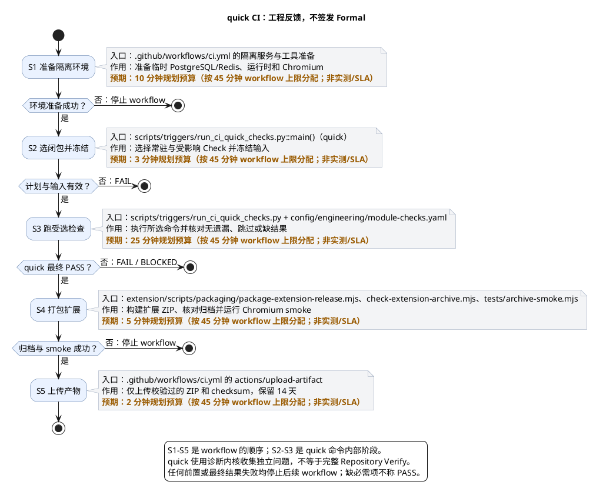
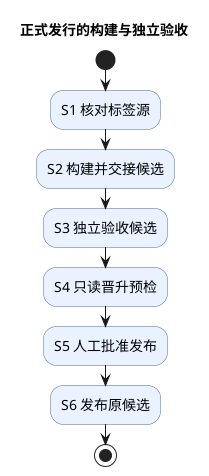

# 1. GitHub 检查与正式发行边界

> 位置：[仓库生命周期](../README.md) → GitHub Actions。普通工程反馈与正式发行是两层；任何快速检查都不是 Formal receipt。


首次在 GitHub 发布请从[第一次 Release 操作手册](github-actions/first-release.md)按顺序执行：先管理员配置与材料，后标签候选、原生验收和手动晋升。本页保留工作流模型与合同，不以流程图代替实际操作步骤。

## 1.1. 分支与 PR：共享快速入口

| 任务 | 命令或操作 | 成功判据 |
| --- | --- | --- |
| 检查 PR | `python3 -m scripts.triggers.run_ci_quick_checks quick --base <完整commit>`；新分支用 `--all` | 必需与受影响 Check 完成；不等于 full Verify/Formal |
| 下载并测试扩展包 | 从同次 quick run 下载 ZIP，校验 `.zip.sha256` 后加载解压目录 | artifact 对应目标 commit；Smoke 不替代真实观看或发行验收 |
| 准备正式候选 | 从受保护的 `v*` tag 触发 release workflow | 单一 Mac/Podman 私有候选与固定交接完成，后续独立执行完整 Repository Verify |
| 晋升公开发行 | 原标签手动续办，已有独立 Formal 链、两道人审授权与 `PUBLISH` | release资产摘要复核并发布；缺证/漂移立即停止 |

`.github/workflows/ci.yml` 在分支 push、`pull_request` 和手动运行时调用：

```sh
python3 -m scripts.triggers.run_ci_quick_checks quick --base <完整commit>
```

新分支没有可比较的前序 commit 时使用 `--all`；本机可用 `plan` 只查看选择，不执行检查。




图中主干箭头表示同一 workflow run 的顺序调用；quick 内部使用诊断内核收集独立问题，最终结果非 PASS 时停止后续 workflow，不把它描述为逐 Check 早停。`S4` 与 `S5` 是 Quick 成功后的同 run 扩展打包/上传步骤，不是 Quick 的独立验收。实际耗时随闭包、缓存及 CI 冷启动变化；图注提供 workflow 总预算分配，不是实测样本。

| 节点 | 命令 | 成功判据 |
| --- | --- | --- |
| S1 准备隔离环境 | `.github/workflows/ci.yml` 的 setup、`pip install`、`npm ci`、Playwright 安装 | Python/Java/Node 与合成 PostgreSQL/Redis/Chromium 就绪；缺项则 workflow 停止 |
| S2 选闭包并冻结 | `python3 -m scripts.triggers.run_ci_quick_checks quick --base <完整commit>` 或 `--all` | 常驻版本/docs，加上按变更触发的规划与受影响依赖闭包被选中；正式专属检查排除在 quick 外 |
| S3 执行受选检查 | `scripts/triggers/run_ci_quick_checks.py` 按 `config/engineering/module-checks.yaml` 执行声明命令 | 无必需 Check 被跳过或缺失；失败/缺环境时不得称 PASS |
| S4 打包扩展 | `node extension/scripts/packaging/package-extension-release.mjs`、`archive-check.mjs`、`archive-smoke.mjs` | 同次 run 的 ZIP 身份、checksum 与 Chromium smoke 匹配 |
| S5 上传产物 | GitHub `actions/upload-artifact` | 只上传 ZIP 和 checksum，14 天保留；非永久发行渠道 |

每节点时间只可作计划预算：S1 10 分钟、S2 3 分钟、S3 25 分钟、S4 5 分钟、S5 2 分钟；这是按 [`ci.yml`](../../.github/workflows/ci.yml) 的 45 分钟 workflow timeout 分配的规划预算，不是实测或 SLA。依赖冷启动、受影响检查、网络及人工下载另计；workflow 超时不能证明该预算充足。入口与边界分别见 [`ci.yml`](../../.github/workflows/ci.yml)、[`module-checks.yaml`](../../config/engineering/module-checks.yaml)、[`run_ci_quick_checks.py`](../../scripts/triggers/run_ci_quick_checks.py)。

检查仍由 `config/engineering/module-checks.yaml` 的模块命令负责，`config/engineering/module-checks.yaml` 的 `scenario_policy.ci_quick` 仅决定 CI 范围：版本与文档始终核对；规划按实际变更触发，受影响模块连同必要依赖执行编译、静态检查、业务测试及扩展构建/浏览器测试。真实发行生命周期留到标签流程，不默认导入真实词库。

快速入口保留输入冻结、缺环境 BLOCKED、测试跳过拒绝和覆盖缺口；输出固定说明 `formal_eligible=false`。托管 Linux runner 只是隔离的工程检查环境，不新增产品交付平台，也不代替 M 芯片 Mac/Podman 验收。临时 PostgreSQL/Redis 仅服务本次合成测试，不能接到用户安装。

PR 没有发布权限，不使用 `pull_request_target`、self-hosted 或发布 Environment，不上传 `tmp/`、API 原始日志、字幕正文或观看记录。Action 固定完整 commit SHA；源码不能在取得 token 后随意替换。参考 [GitHub 安全使用说明](https://docs.github.com/en/actions/reference/security/secure-use)。

### 1.1.1. 下载与加载扩展

Quick checks 成功后，同一 run 使用现有 `extension/scripts/packaging/package-extension-release.mjs` 构建并校验 ZIP，在隔离 Playwright Chromium profile 加载 service worker 和 popup，再上传 `lexiflow-chrome-extension-<完整commit>` artifact，保留 14 天。此结果是自动化加载 smoke，不是人工 Chrome 安装或正式 Release 验收。run 的 event、分支及完整 commit 必须与目标源码对应；PR run 可能对应 GitHub 合并测试 commit，而非 PR head。

Actions 网页下载的是外层 artifact ZIP；先解开它，得到内层 `lexiflow-extension-<softwareVersion>.zip` 与同名 `.zip.sha256`。可使用 `gh run download <run-id> --name lexiflow-chrome-extension-<完整commit> --dir <目录>` 直接解开外层。下载需要 GitHub 登录及仓库读取权限；过期后不能将旧下载入口承诺为永久发行。校验内层：

```sh
cd <下载目录>
shasum -a 256 -c lexiflow-extension-<softwareVersion>.zip.sha256
```

随后将内层 ZIP 解压到稳定目录；该目录根部必须有 `manifest.json`、`build-identity.json` 与运行资源。打开 `chrome://extensions`，启用开发者模式，点击“加载已解压的扩展程序”，选择这个目录，而不是外层 artifact 目录。API 仍需单独按本机安装说明运行；ZIP 不包含后端或词库。更新后替换该解压目录并在扩展管理页重新加载。

开发者可加载可信的解压扩展；ZIP 仅是 Chrome Web Store 上传格式，须经商店审核才可作为普通用户安装方式。GitHub ZIP、自签名 CRX 与自动生成的 Source code ZIP 都不是通用安装包；自托管还受企业策略约束，本项目不修改浏览器策略。参见[Chrome 分发规则](https://developer.chrome.com/docs/extensions/how-to/distribute)、[加载解压扩展](https://developer.chrome.com/docs/extensions/get-started/tutorial/hello-world#load-unpacked)及[商店上传](https://developer.chrome.com/docs/webstore/publish)。

## 1.2. 正式标签：完整验证与独立验收

`.github/workflows/release.yml` 将 `v*` 标签准备与显式手动晋升分开。标签阶段及手动晋升先在托管运行器验证精确标签属于已集成 `origin/main`，并核对 commit、干净源码与三段正式版本完全一致；SNAPSHOT、dirty 输入或标签漂移均拒绝。随后唯一专用 Apple Silicon macOS/Podman runner 构建 JAR、扩展和 ARM64 镜像，组装真实候选并留下固定本机 handoff。

Actions 的职责止于构建和交接，不先跑开发差异报告或完整 Repository Verify。负责人在原 checkout 用正式发行 Task 的 `submit --release-handoff` 送验干净提交和精确候选；独立原生 validator 负责完整 `repository-baseline`，reviewer 只读复核，`check` 只核 receipt/hash DAG。普通代码 Task 仍使用开发报告送验，两种输入不混用。

下图只表示成功路径；任何来源、候选、验证、证据或保护前置失败均以 `FAIL` / `BLOCKED` 停止，不进入后续发布。



S1→S2 是 GitHub 托管 source job 到专用 runner prepare job；S2→S3 是原 checkout 的原生交接，不是 Actions 自动签证。S3→S4 由负责人从原标签手动 dispatch，填写原 submission 和 `PUBLISH`；构建和只读预检使用无审批的 `lexiflow-release-private`，S4→S5→S6 仅在 promotion Environment 要求一次人工批准再发布。单维护者可按既定保护批准本人触发的发行，但不能代替独立自动验证或原生角色。

| 节点 | 命令或操作 | 成功判据 |
| --- | --- | --- |
| S1 核对标签源 | `node ops/release/integrity/source-build-identity.mjs --tag <tag>` | 精确 tag、commit、干净输入、正式版本与 runner readiness 匹配 |
| S2 构建并交接候选 | `node ops/release/workflow/run-release-workflow.mjs prepare <request>` | 私有环境仅允许正式 tag、无需人工审批；候选身份、制品及固定 handoff 完整，不签验收 |
| S3 独立验收候选 | `"$LEXIFLOW_RELEASE_NODE_BIN/node" ops/release/workflow/run-release-workflow.mjs formal <action> <id>` | 以固定 handoff 送验；不同真实 actor 完成完整基线、只读审查及 DAG 核对，无需开发 diff |
| S4 只读晋升预检 | `"$LEXIFLOW_RELEASE_NODE_BIN/node" ops/release/workflow/run-release-workflow.mjs resume <submission> <tag>` | 从原标签重核既有候选和 Formal，不构建、不测试、不发布 |
| S5 人工批准发布 | GitHub Environment `lexiflow-release-promotion` | 唯一一次人类审批，owner 按保护规则批准；不是测试或独立验收结果 |
| S6 发布原候选 | `"$LEXIFLOW_RELEASE_NODE_BIN/node" ops/release/workflow/run-release-workflow.mjs resume <submission> <tag> --publish` | 实际写入前重核新鲜证据、固定资产、当前保护和本次运行批准；只有此步取得发布凭据，远端状态确认 |

job timeout 是单次执行上限，不是任务估时或逐次累积的发布审批预算：source 5 分钟，prepare 180 分钟，promotion-precheck 30 分钟，promotion 45 分钟。完整原生验收的执行与审阅另按本次冻结计划安排，不重复计入 Actions prepare。命令与精确参数见 [Delivery Gate](../reference/delivery-gate.md) 和[首次发行准备](github-actions/first-release/preparation.md)。

正式晋升仍须同候选制品摘要、来源与许可、干净初始化、同卷重启、初始化中断恢复和关键组件故障、真实独立 Formal 链。两代合成资料测试不替代真实候选；镜像标签、JAR/扩展内嵌身份、manifest 的 `buildIdentity`、源码摘要和 commit 必须一致。晋升只消费原候选，不重新构建或覆盖已有正式身份，不承诺任意历史数据库迁移。

## 1.3. 仓库管理员准备

1. 按[Runner 安装与管理](github-actions/first-release/preparation.md#16-runner-安装与日常管理)通过共享 Release 工具自动配置；使用唯一、独立、受控的 Mac runner，标签为 `self-hosted`、`macOS`、`ARM64`、`lexiflow-release`；该标签不能匹配多台机器。专用工作目录不得被其他 workflow 使用、清理或切换源码。不要使用日常开发目录或实际用户安装；禁止不可信 PR 和普通分支进入该宿主。公共仓库更需严格限制专用 runner 的执行来源。
2. 预装 Node.js 22、Python 与 `requirements-dev.txt`、Temurin 25、Podman Compose、Docker 兼容客户端及扩展依赖/Playwright。只使用已确认的 Podman Unix endpoint；流程不创建或更改 machine。
3. 创建 `lexiflow-release-private` 和 `lexiflow-release-promotion` 两个 Environment，只允许受保护正式标签。private 无 required reviewer，仅给隔离测试能力；promotion 要求 owner 人工批准，单维护者允许本人审批，管理员 bypass 保持关闭；原生验证与审查仍按 [Harness](../../harness/agent-policy.md#冻结验证与独立性) 保持不同真实 actor。限制标签创建/移动与 workflow 修改权限；Environment 本身不是 Formal 验收。参考 [GitHub Environment 配置](https://docs.github.com/en/actions/how-tos/deploy/configure-and-manage-deployments/manage-environments)。
4. 配置同一固定 checkout 的绝对路径 `LEXIFLOW_RELEASE_WORKSPACE` 和私有构建请求文件绝对路径 `LEXIFLOW_RELEASE_REQUEST_FILE`；工作流不在该路径执行 checkout，负责人须先在已授权的干净源码目录准备精确标签和 commit。两处 Environment 的 workspace 必须一致。在两个 Environment 配置相同的 `LEXIFLOW_RELEASE_NODE_BIN` 和验证能力变量 `LEXIFLOW_RELEASE_JAVA_HOME`、`LEXIFLOW_RELEASE_TEST_REDIS_ENDPOINT`、`LEXIFLOW_RELEASE_ARM64_DOCKER_HOST`、`LEXIFLOW_RELEASE_GRADLE_CACHE`、`LEXIFLOW_RELEASE_NPM_CACHE`；在两个 Environment 将同一隔离 PostgreSQL 测试 JDBC 放入 `LEXIFLOW_RELEASE_TEST_JDBC_URL` secret，不能指向实际安装。缓存仅为构建依赖，不包含用户脚本或私有数据。
5. 在同一 OS 用户与稳定 checkout 配置真实 Codex 运行环境，确保历史 actor 元数据、Gate records 与 Verify 附件可重读。仅复制 JSON、UUID 或将原始记录上传为 Actions artifact 不满足此条件。
6. 确认上述隔离和保护后，再将 repository variable `LEXIFLOW_RELEASE_RUNNER_READY` 设为 `true`。它仅是管理员配置确认，不是测试、机器身份或独立验收证据。

发行原生角色通过[首次发行准备](github-actions/first-release/preparation.md#13-在原-checkout-完成真实独立-formal)的 `formal` 入口共用受控执行环境；既有链与同候选 runtime 输出由同环境的 `resume` 只读消费，缺 check 不会补签。Formal receipt 依赖真实原生 actor/session 元数据和固定输入附件，不能跨机器仅复制 UUID 或填写一个 PASS JSON。执行状态及缺失资源见变更状态页；实际 GitHub 配置、发布和标签操作需要单独授权。


## 1.4. 候选完整性消费

`node ops/release/workflow/run-release-build-pipeline.mjs verify /absolute/request.json` 接收 `candidateDirectory`（绝对路径）与 `candidateSha256`。入口只读核对 marker、规范 manifest、摘要 sidecar、全部制品和许可 notice，以及扩展 ZIP 内嵌身份；缺失、额外文件、非普通文件、symlink 或漂移均拒绝。返回 `scope=candidate-integrity-only`，不执行候选脚本或容器；结果不永久信任可变目录，消费前须重核实际字节。clean SNAPSHOT 可用于机制验证；正式发布还须匹配精确正式标签及独立验收报告中的同一候选摘要。


## 1.5. 真实单容器候选验收

`eng.release.candidate-runtime` 消费 `LEXIFLOW_CANDIDATE_RUNTIME_REQUEST` 指向的严格请求：仅 `target`，含 `candidateDirectory` 与 `candidateSha256`。固定请求由本机工作流生成，路径按干净正式软件版本派生为 `tmp/quality/release-workflow/<softwareVersion>/candidate-runtime-request.json`，不接受任意 handoff。既有版本的原始交接文件不移动、不覆盖、不删除；同版本残留仍失败关闭。

目标候选必须与干净源码完整身份一致。Check 在 Apple Silicon macOS + Podman 以唯一归属名字/卷和固定 loopback 18082运行单镜像；证明初始化、精确软件/协议/资料及扩展身份、单容器、同卷停止重启、初始化中断恢复、不兼容卷拒绝、关键组件异常与精确清理。没有真实故障观测、事实不完整或清理不确定不能 PASS。正式18080与开发18081不因此被停止；公开发行后另从真实渠道在正式端口安装及 Chrome for Testing 试跑，不把候选18082结果冒充该安装。

合成两代资料通过现有 `eng.release.lifecycle-runtime` 验证构建与运行机制，资料不具备正式再分发资格，不能替代真实资料候选。API端口冲突、名字冲突、镜像不可用或未知资源均清晰失败，不自动接管、删除或放宽超时。

## 1.6. 联合消费候选与既有验收

```sh
python3 -m scripts.acceptance consume-candidate --submission-id <uuid> --candidate-directory /absolute/candidate
```

从本次完整 Formal 链的 repository-baseline 报告取得候选 Check stdout，核对附件字节、摘要、冻结输入、完整运行阶段和来源。候选摘要从证据派生，不由调用者另传。消费执行固定 Node integrity proof，末尾重读链与附件，不能补签、构建或启动容器。完整干净正式标签及来源许可仍是晋升前置；clean SNAPSHOT 不因此取得发行资格。

## 1.7. 正式候选晋升

```sh
python3 -m ops.release.workflow.promote_verified_release --submission-id <uuid> --candidate-directory /absolute/candidate
```

默认只读预检，不构建、归档、加载、推送或写 GitHub/GHCR，不需要发布凭据。只有显式 `--publish` 及受保护 Environment 对本次 dispatch 的人工批准才进入远端写入；重跑旧 run 不继承批准，恢复须新 dispatch 和新批准。每次写前重核固定候选、干净正式源码、tag、不可变配置、真实独立 Formal 链和许可核准；同版本不同内容拒绝。

新正式发行只晋升一份候选 `runtime-image` 到 `ghcr.io/<owner>/<repo>`，仅 `linux/arm64`。推送后匿名按 registry manifest digest 读取并确认 config ID，不能拿候选 archive hash 或 image config ID 代替 registry digest。候选、离线 image archive 和内部 marker 不作为用户附件。

Release 只上传三项自定义附件：扩展 ZIP、第三方对应源码包、`release.json`；逐项核对名称、大小与 SHA-256 后才发布。对应源码包在候选 assemble 时完成并参与验收，晋升原样复制，不在发布阶段重新构建。`release.json` 绑定软件/源码/API/SQL/资料身份、唯一镜像 digest/config/platform 和两个下载制品及全部来源对应关系。正文展示校验值但不作为机器输入。

正文来自精确发布提交的 `ops/release/notes/<version>.md`。缺失、空白或版本不匹配在任何远端写入前拒绝；维护者负责功能、修复、使用方式、前置及限制，发布器只自动补真实链接、摘要和固定 digest 的可复制命令。页面首先展示两步使用。

GHCR 与 Release 不具备原子事务。镜像已上传不等于发行成功；私有 package、draft、部分资产或写请求未知都保留现场，先只读查明，不盲目重复写入、删除或覆盖。同一原候选只有在远端状态确定且摘要完全一致时才可按恢复合同续办。首次 package public 设置由管理员完成，认证拉取不等于匿名拉取。[GHCR](https://docs.github.com/en/packages/working-with-a-github-packages-registry/working-with-the-container-registry)、[不可变发行](https://docs.github.com/en/code-security/concepts/supply-chain-security/immutable-releases)。

凭据隔离不变：`GITHUB_TOKEN` 的 Contents/Packages write 仅在 promotion job 注入；其 Actions read 只用于核对当前运行和批准历史；`LEXIFLOW_RELEASE_CONFIG_TOKEN` 仅用作 Administration read 配置查询，固定HTTPS目的地、无重定向、不传构建子进程或日志。不以本机 token 存在替代人类批准。

## 1.8. 构建资料与本机交接

负责人先以实际 JAR 的 `ReleaseDatasetCommand export` 从已发布资料及真实 `approval-file` 导出发布 ZIP，并由实际 JAR 校验；来源词库 ZIP 不是发布格式。来源/版本/摘要未变的静态许可材料可按证据复用，旧 PASS 不能复用为新候选资格。

本机入口 `node ops/release/workflow/run-release-workflow.mjs prepare /absolute/private-request.json` 的请求含 `releaseTag`、`dataset`（`path`/`sha256`/`releaseId`/`preparationId`/`ruleId`/`sqlVersion`）、`noticesRoot`、已存在且为空的 `outputParent`、本机 Podman Unix `endpoint`。JAR、扩展、SQL、基础镜像锁和许可关联由固定源码派生，不接受任意shell或完整descriptor。新单容器验收不要求历史双镜像 previous 候选，失败恢复由目标本身真实中断与重试证明。

`prepare` 留下同版本目录的固定 `handoff.json` 与 runtime request；这些私有文件不上传。原 checkout 的真实不同原生 actor 完成 Formal 后，负责人从原正式tag手动dispatch填写submission与 `PUBLISH`，自动只读预检，再经 promotion 唯一一次人工批准发布。运行环境和精确命令见[准备页](github-actions/first-release/preparation.md)。

## 1.9. 安装与开发隔离

使用者只复制正式Release正文的固定digest单条run命令，再安装启用同页扩展；不下载主tar、镜像tar、源码或执行初始化脚本。Podman已安装并运行、Chrome已安装是前置，不宣称全新机器从零两步。正式容器/卷/18080、开发名字/卷/18081、唯一验收资源/18082彼此分开；数据库不映射宿主。实际使用见[用户指南](../user/podman-macos.md)。
