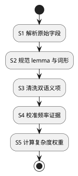

# 1. 核对词库导入记录处理与字段 Reference

> 位置：[仓库生命周期](../../README.md) → [词库导入](../lexicon-import.md) → 记录处理。需要核对来源记录如何映射为发布数据时读本页；字段、频率与选择规则由当前导入实现约束，不是每次操作都必须逐项执行的步骤。

## 1.1. 单条记录提取



| 来源字段 | 提取与清洗 | 输出字段 |
|---|---|---|
| `word` | NFC、去首尾空白、连续空白折叠、英语小写；单词为 `word`，空格分隔 2–5 词为 `phrase`；观看只枚举连续 1–3 词。 | `lemma`、`entry_kind` |
| `exchange` | 以 `/` 分项、以首个 `:` 分键值。`p/d/i/3/r/t/s` 的值去重为词形；纯 `0:lemma` 派生行归并到 lemma。ground 混合行按下述来源锁保留独立身份。 | `lexicon_form` 中的屈折形式行 |
| `translation` | 按行切分，清理空白和词性前缀；有普通释义时移除仅 `[网络]` 行。完整来源表达保留；导入期保留来源有序候选；已受核通用默认义按有限 curation 选择，其余仍取来源第一项并进行短释安全校验后发布（未核不等于最常见），不在观看时临时截取。首项无效不扫描后续项补位；释义括号不平衡只将本词条置为 BLOCK，原文留在受控来源文件，CSV 列结构损坏仍阻止发布；具体解析边界见[默认首义规范](../../../openspec/specs/product-architecture/spec.md)。 | 导入内存中的来源表达；安全时持久化 `lexicon_entry.gloss` |
| `definition` | 统一换行和空白；缺失时保留来源未提供状态，不伪造英文定义。 | 离线清洗依据，不进入观看查询表 |
| `tag` | 小写、去重；仅 `cet6`、`ky`、`toefl`、`ielts`、`gre`、`sat` 计入复杂词表。 | 导入内存中的复杂标签及构建期打分所需 `complex_list_count`；不作为 runtime 字段 |
| `bnc`、`frq` | 只接受正十进制排名；`0` 或非数值为缺失。 | BNC 正整数排名写入 `frequency_rank`；BNC/FRQ 排名用于导入计算 Zipf 与 `priority`，不持久化 `ranked_word` |
| `oxford` | 按导入来源合同读取原始标记。 | 来源审计证据；不作为用户档位或缺失 BNC 排名时的运行时回退 |
| `collins`、`phonetic`、`pos`、`detail`、`audio` | 不参与首批释义、频率或权重计算。 | 诊断或忽略 |

ground 同时有独立土地义和 `0:grind/1:dp` 关系，不能整行当纯派生省略。适配器只对这一已核来源行验证独立首义表达及完整 exchange 关系；漂移拒绝导入。独立 ground 仅接收来源明确的 grounds/grounded，混入的 grinding/grinds 留给 grind；不生成 grounding。修正内容及接受形式进入 preparation 摘要，其他纯派生与 Oxford 继承不变。恢复两个真实身份后，ground 表面按现有合同先歧义拒绝，不表示选择了地面或研磨语境义；不改默认首义、排名或 Top N。

## 1.2. 频率与权重

`bnc`、`frq` 是排名而非 Zipf，数值越小越常见。

| BNC / FRQ | `rank` | `frequency_zipf` |
|---|---:|---:|
| 两者均为正数 | `min(bnc, frq)` | `roundHalfUp(clamp(8 - log10(rank), 0, 8), 2)` |
| 仅一个为正数 | 该值 | 同上 |
| 均缺失 | 无 | `0`，不具备 L1 资格 |

```text
frequency_fit(zipf) = 0,                              zipf <= 2.5 or zipf >= 6.0
                      (zipf - 2.5) / 1.8,             2.5 < zipf <= 4.3
                      (6.0 - zipf) / 1.7,             4.3 < zipf < 6.0

complex_list_count = unique(cet6, ky, toefl, ielts, gre, sat in tag)
raw_priority = round(1000 × (0.55 × frequency_fit +
                             0.45 × (1 - exp(-complex_list_count))))
priority = 0 when rank is missing; otherwise raw_priority
```

运行时同时保留可空 BNC `frequency_rank` 与统一 `priority`；前者供用户档位筛选，后者供 HINT 展示／预热，0 表示不预热，不表示 BLOCK。HINT 与 BLOCK 仍按 gloss 是否为空区分。排序策略明确简化，不保证旧分序列等价；需记录全量新旧排序差异并回归新策略。常见基础词虽不展示，也可以作为准确词形的负向缓存；其他长尾词形保留在 SQLite。频率仅在新来源批次中整体重算，已发布版本不会由用户行为
增量更新。

`reliable` 的 `bnc=3271`、`frq=3504` 得 `rank=3271`、`frequency_zipf=4.49`；其
`cet6, ky, toefl, ielts` 得构建期 `complex_list_count=4`、`priority=930`。

公开排名只取 BNC 正整数并写入可空 `frequency_rank`；FRQ 不混入用户排名，`priority` 仍为提示／预热分数。用户 Top N（默认 1500，可选 1000/1500/2000）只筛选有排名且其他条件合格的普通单词；固定功能词、短释、歧义和短语规则独立生效。档位不改发布词库。对没有 BNC 排名的单词，导入继续使用 Oxford 基础词规则。
重复表达清洗在构造导入行时执行；真实不同义项保留，默认短释优先取离线受核的通用常见义，未覆盖词仍按来源首候选准备并明确未核，不要求实时上下文消歧。没有可核对的已发布默认义项仍不展示；本地两列候选 CSV 不可绕过来源和发布校验直接作为正式导入。结构变化直接修改 `infra/sqlite/schema.sql`，显式重建本项目开发库后完整重新导入，不维护旧结构升级或旧数据资格回填。未完成准备的数据不发布；数据库不保存中间生命周期状态。来源清单绑定预处理策略、许可和文件摘要；不得把列存在当作资料已经处理。

## 1.3. 规范输入与数据库

导入命令会按首行自动识别 StarDict 原始 CSV；它不会生成或要求中间的大型规范 CSV。保留
`lexiflow-lexicon-v1.csv` 仅用于已经按该合同准备的其他受控来源，其首行必须是：

```text
lemma,chinese_gloss,definition,aliases,inflections,frequency_zipf,frequency_source_id,frequency_license_id,frequency_ref,complex_evidence,dictionary_source_id,dictionary_license_id,dictionary_ref
```

| 表 | 核心字段 |
|---|---|
| `lexicon_dataset` | 已发布资料版本、来源清单、来源行数、准备词条数、查询行数及准备规则。 |
| `lexicon_entry` | `entry_id`、`lemma`、`gloss`、`canonical_form`、`priority`、可空 `frequency_rank`（仅 BNC 正整数排名）。`complex_list_count` 仅构建期打分，不持久化；`ranked_word` 非 runtime 字段。 |
| `lexicon_form` | 只存查询窗口内的准确词形与 `entry_id` 映射，不重复短释和分数。 |

查询一次批量关联 `lexicon_form` 和 `lexicon_entry`；同形对应多词条时返回全部候选，不在数据库里选择第一条。字段与约束以最新 SQL 为准。

## 1.4. 确定性短释清洗

Lexicon 在 Java 导入准备阶段执行纯文本清洗，不调用模型、数据库或网络。`StardictGlossPreparation` 统一 `firstCandidate`、`candidates` 与 `safeGloss`：保持五种顶层分隔符、全段括号配对、空首项不补位，长度按 code point、显示偏移按 UTF-16。首候选最多 24 个 code point 且至少一个汉字；未知标签、坏括号与非法字符不得为提高覆盖率而放行。

`StardictGlossCleaner.clean(lemma, sourceGloss)` 返回 `Result(workingGloss, candidate, decisiveRule, matchedRules)`。已有安全首义立即返回 `existing_safe`；否则依次执行 `source_label`、`english_expansion`、`angle_tag`、`person_header`、`leading_han`、`acronym_expansion`、`han_spacing`、`mixed_spacing`、`trailing_parenthesis`、`medical_insert`，每步只执行一次并重新解析校验，首次安全即停止，最终仍不安全为 `unresolved`。规则读取来源限定时始终使用原文；不覆盖受核验 curated 候选，不恢复未批准的词形推导或其他实验规则。纯文本组件不裁决基础词、低信息或频率资格。

前缀只识别白名单元数据，不能跨空首项寻找后义；缩写展开必须核对字母对应。尾圆括注仅在完整首候选为 1–24 个纯汉字加一个完整配对尾注时清理，保护纯罗马数字和 1–2 个 ASCII 字母技术符号；不全删句中、前置或坏括号。医学补字要求原来源明确带 `[医]`，英文词间空格与有意义术语保留。

资格使用共享功能词集合和“命中低信息启发式且实义词少于两个”的条件，不把实义词门槛泛化到所有短语；`all_basic_phrase` 独立于单词标记。基础词优先，原来源身份、别名和首义一致性不变。一次准备结果用于最终词条和词形发布，BLOCK 仍参与同形歧义；原始资料留在受控来源，规则轨迹只用于内存统计或本机审计，不逐词入库。

验收覆盖每个场景的正反例、步骤顺序、幂等与边界，并在冻结来源上逐 ID 只读重放、核对互斥计数及已有安全记录。可选增强按净终态贡献达到批准的千条门槛才启用，基础安全与身份合同不受门槛裁剪；格式通过不等于语义正确、已发布或真实观看覆盖。验收不得修改真实产品数据，独立验证仍按 Harness 执行。

## 1.5. 有界工程候选补充来源

内嵌短语目录经事实、许可和真实独立内容审核后由正常 Java 事务发布；不要求用户逐词签字，也不冒称人类已答复。只发布有精确证据绑定的 REVIEWED 条目及同一子集来源，PENDING、缺审、许可冲突或摘要漂移拒绝发布。补充料不改原件、不借用 BNC、不替换完整词库。目录内容完整性锁不认证审核者身份；事实、署名、真实审核来源及竞争边界见[有界术语来源](../../system/lexicon/reviewed-phrases.md)。

## 1.6. 受核通用默认义

`StardictCsvReader.CURATED_GLOSSES` 复用有限离线映射。plane→飞机、tissue→组织、equal→相等的、nerve→神经、mostly→大部分、cook→烹调、wrap→包；spinal→脊柱的属于现代词义质量纠错。新增项绑定完整清理后来源摘要和确切候选，来源漂移、缺义、空或非法表达拒绝导入，不回退其他义。所有原候选与顺序仍在受控 ECDICT 原件/导入来源表达中保留，不添加逐义运行表。原三项自编短释不变。来源锁、默认和审核依据共同进入 preparation/generation 身份。

依据是独立核对的 [WordNet 3.1 官方包](https://wordnetcode.princeton.edu/wn3.1.dict.tar.gz) 中 exact lemma 的全部 POS/sense key/tag count，并逐字节 offset 核对含义。plane 飞机21/数学平面16、tissue 组织37/纸4、equal 形容词31/等于动词13/同辈1、mostly 大部分10/通常3；cook 两个烹调义各9/厨师7，wrap 包覆5/缠绕4/外套1，nerve 神经6/勇气5。后几项证据中等，nerve 另以 [Cambridge 现代语义](https://dictionary.cambridge.org/dictionary/english/nerve) 交叉核对。spinal 全零，改义依据 [Oxford 现代形容词定义](https://www.oxfordlearnersdictionaries.com/definition/english/spinal)，不冒称义频证明。WordNet 原版权/免责保存在内嵌 `lexicon/wordnet-notice.txt`；数据库仅研究使用，产品不新增运行依赖，词典网页仅核义、不复制全文或例句。

[WordNet 官方说明](https://wordnet.princeton.edu/documentation/wn1wn) 明确这些次序只是小型标注样本的估计；[tag count 合同](https://wordnet.princeton.edu/documentation/senseidx5wn) 的零表示未标注，不等于概率零。跨 POS 不能按文件先后挑义；BNC/FRQ、priority、ECDICT pos 比例不构成义频依据。未核词的来源首项不是“已证明全库最常见”。fatty/knob、net/crack 等未据充分依据改默认的词保持；当前语境不同本身不是全局改义证据。数学 plane、厨师 cook、勇气 nerve、缠绕 wrap 仍可能不适配；不会实时换义，也不称已实显验证。

### 1.6.1. 来源质量覆盖与完整词

`reviewed-source-defaults.tsv` 是离线质量数据，不是观看期词白名单。每项锁定完整原翻译、exchange、确切来源锚点、独立词义标记和核义链接；内容摘要进入 preparation/generation 与补充来源 manifest。中文短释由项目作者依据词义事实自编，以项目 MIT 许可提供；链接词典只用于核义，不复制其全文、中文释义或例句，也不冒称独立验收已完成。

缩写 `that's` 不能借用插入语 `that is` 的改述义；`whisk` 的搅拌、`horizontal` 的水平特性、`crash` 的撞击为合理常用短义。`Anglican` 指圣公会归属，不是盎格鲁人。`ease` 采用“轻松”表达常用名词的舒适／自如义，保留动词减轻等候选；这是质量判断，不是声称名词跨 POS 概率最高。原译文和排序不变。来源或关系漂移时拒绝导入，不能自动套用纠错。

固定 ECDICT 原件中的 `marbled` 经独立形容词义核查后由正常准备补齐，保留独立稳定词条；`marble` 不再把这个已核独立形式归为本词变形，其他词形保留。`in addition` 使用原来源的完整固定搭配“另外”，不向组成词 `addition` 改写数学默认。

查询合同保留内部 ASCII／Unicode hyphen 和直／弯 apostrophe 的完整英文词，等长规范化用于查表与定位，不改变原 UTF-16 偏移。`non-stick` 仍可使用已有整体释义，不能拆出 `stick` 的棍；独立 `stick`、引号或普通标点边界仍正常匹配。没有整体发布资格的复合词按通常资格处理，不用全部禁用连字符内容代替修复。离线准入的字母数／词元窗口仍沿用既有条件；完整词查询修复不扩大长连字符词准入，也不删除已发布短复合词。单默认仍无法自动区分 stream/crack/spear/knob/dish 的所有语境，合法常用默认与当前语境错配分开报告。
