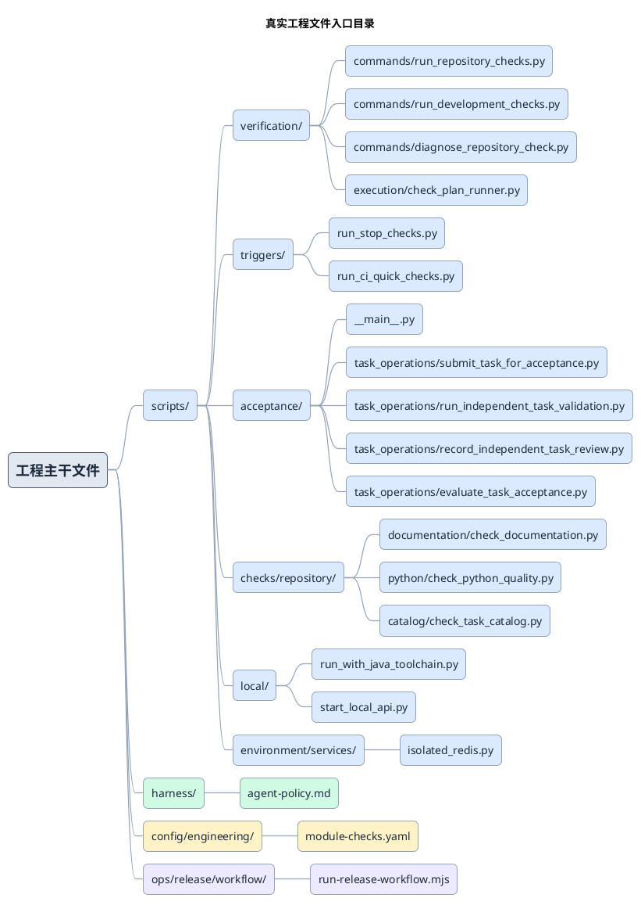
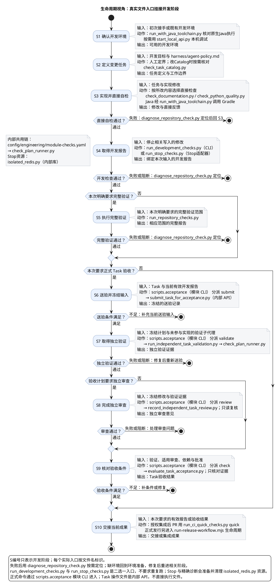

# 1. 工程三体系与文件生命周期

[仓库生命周期](../README.md) → 工程治理总览。本文面向首次接手仓库的开发者：先理解治理模型，再从真实文件目录和使用生命周期定位实现。Markdown 负责解释与跳转，不是编号对象。

## 1.1. 工程治理的职责

- **质量检查。** 选择并执行适用于输入的 checks，产出检查事实报告；报告本身不裁定 Task 是否可信或获批。
- **交付验收。** 核对 Task 证据的充分性、独立性、当前性、依赖与批准；需要独立验证时复用质量检查能力，不另建检查引擎。
- **工程协作与运行支撑。** 提供工作包、身份、工具链与隔离资源，使检查和验收按边界执行；支撑能力不是先后阶段。

开发反馈用于尽早修错，任务验收需要独立证据，正式发行针对确定候选取得发布资格。操作入口见[编码后执行门禁](../scenarios/run-repository-gates.md)。

## 1.2. 核心文件目录

下图按真实目录定位开发、验证、验收和发行交接的核心文件，不是全仓脚本清单；叶子标签保留相对所在目录的实际路径。具体命令和类型见[脚本职责索引](../reference/scripts.md)。

目录图展示实际文件位置；公开 CLI、内部库和机器声明按[脚本职责索引](../reference/scripts.md)中的真实路径定位。

## 1.3. 生命周期：真实入口贯穿使用

下图从准备与实现走到任务交接，按真实文件名标明对应入口与内部实现。只需开发反馈时可在直接自检后交接，后续图示用于需要开发报告的任务。完整验证和正式验收按本次要求进入，正式发行在交接处分流，不串成每次必跑的长链。

阶段说明与深入位置如下。

| 阶段 | 输入 → 动作 → 输出 | 关联文件 |
| --- | --- | --- |
| 准备与定界 | 开发目标／环境 → 定义变更边界并准备需要的本机工具 → 可执行工作范围 | [`run_with_java_toolchain.py`](../../scripts/local/run_with_java_toolchain.py)、[`start_local_api.py`](../../scripts/local/start_local_api.py)、[`agent-policy.md`](../../harness/agent-policy.md)；必要时 [`check_task_catalog.py`](../../scripts/checks/repository/catalog/check_task_catalog.py) |
| 实现与直接反馈 | 任务与修改 → 按受影响部分做静态、编译或直接回归 → 修改及反馈 | [`check_documentation.py`](../../scripts/checks/repository/documentation/check_documentation.py)、[`check_python_quality.py`](../../scripts/checks/repository/python/check_python_quality.py)、[`run_with_java_toolchain.py`](../../scripts/local/run_with_java_toolchain.py)；必要时产品模块原生命令 |
| 开发报告 | 停止相关写入的完整 diff → 按显式 triggers 与消费依赖选择日常 checks → 绑定本次输入的开发报告 | [`run_development_checks.py`](../../scripts/verification/commands/run_development_checks.py) 或 [`run_stop_checks.py`](../../scripts/triggers/run_stop_checks.py)；[`module-checks.yaml`](../../config/engineering/module-checks.yaml)、[`check_plan_runner.py`](../../scripts/verification/execution/check_plan_runner.py)；Stop 资源路径涉及 [`isolated_redis.py`](../../scripts/environment/services/isolated_redis.py)；失败定位 [`diagnose_repository_check.py`](../../scripts/verification/commands/diagnose_repository_check.py) |
| 可选完整验证 | 明确要求的完整范围 → Repository baseline → 完整验证报告 | [`run_repository_checks.py`](../../scripts/verification/commands/run_repository_checks.py)；失败定位 [`diagnose_repository_check.py`](../../scripts/verification/commands/diagnose_repository_check.py) |
| 任务验收 | Task 与当前有效报告 → 冻结输入、独立验证、适用审查与条件核对 → Task 验收证据 | [`scripts.acceptance`](../../scripts/acceptance/__main__.py) 分派 [`submit_task_for_acceptance.py`](../../scripts/acceptance/task_operations/submit_task_for_acceptance.py)、[`run_independent_task_validation.py`](../../scripts/acceptance/task_operations/run_independent_task_validation.py)、[`record_independent_task_review.py`](../../scripts/acceptance/task_operations/record_independent_task_review.py)、[`evaluate_task_acceptance.py`](../../scripts/acceptance/task_operations/evaluate_task_acceptance.py)；独立验证复用 [`check_plan_runner.py`](../../scripts/verification/execution/check_plan_runner.py) |
| 正式发行 | 授权集成源码与发行请求 → 准备候选、完整验证、绑定候选的独立验收及显式晋升 → 发行交接 | [`run-release-workflow.mjs`](../../ops/release/workflow/run-release-workflow.mjs)；[`run_development_checks.py`](../../scripts/verification/commands/run_development_checks.py)／[`run_repository_checks.py`](../../scripts/verification/commands/run_repository_checks.py)；[`scripts.acceptance`](../../scripts/acceptance/__main__.py) 及其 Task 操作文件 |

失败或阻断回到相应实现、环境准备或证据补齐；相关输入变化后重新执行受影响步骤。[`diagnose_repository_check.py`](../../scripts/verification/commands/diagnose_repository_check.py) 用于定位，不代替报告。开发报告不是 Task 验收；Formal review 与 check 只读冻结证据，不重跑检查。Stop 会准备并清理隔离服务，显式 development CLI 调用者则须自行准备环境。

## 1.4. 深入入口

- [质量检查体系](quality-checks.md)：检查能力和报告边界。
- [交付验收体系](delivery-acceptance.md)：Task 证据与独立性。
- [工程协作与运行支撑](engineering-support.md)：工作包、身份、环境与工具链。
- [编码后执行门禁](../scenarios/run-repository-gates.md)：按开发反馈、任务验收或发行目标选实际操作入口。
- [脚本职责索引](../reference/scripts.md)：公开 CLI、触发适配器、内部库及声明的完整索引。

长期人类规则只在 [Harness](../../harness/README.md) 与 [工程规则](../../AGENTS.md) 维护；本文解释模型和导航，不复制机器合同。
