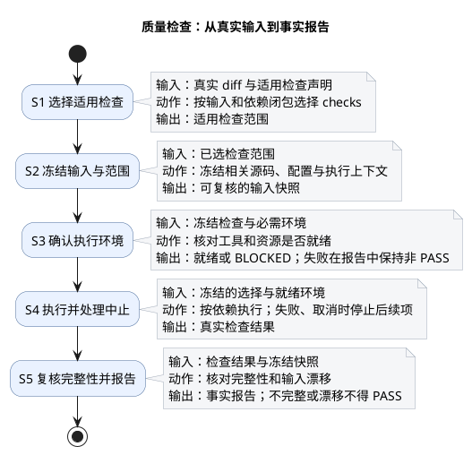

# 1. 质量检查体系

[工程治理三体系总览](engineering.md) → 质量检查。本文回答“这份输入实际执行了哪些 checks、结果是什么”；不裁定 Task 证据是否充分、独立或获批。

## 1.1. 目的与边界

质量检查从真实输入和适用合同选择检查范围，冻结输入与执行上下文，核对环境后调用共用检查引擎，并复核执行完整性、形成事实报告。检查报告只证明其冻结范围内的结果；`PASS` 不自动证明正式验收条件。

场景（开发、Formal 验收、发行）、范围（`development-change`、`development-baseline`、`repository-baseline`）、触发入口（CLI、Stop、CI）及 actor 要求是不同维度，不是并列门禁层次。日常风险入口和完整 Verify 可选择不同范围；正式独立 validation 复用同一检查引擎，不另建第二套 checks。

## 1.2. 核心流程

上图按交付执行模式概括能力主线，不展开逐项声明；诊断模式可以继续收集互不依赖的错误，但缺少前置的检查仍不能执行。真实选择按当前输入与依赖合同计算。环境确认失败、检查命令失败或取消会停止相应后续执行并进入非 PASS 报告；执行期间或结束时发现相关输入漂移、结果不完整同样不能报告 PASS。状态语义以 `PASS`、`BLOCKED`、`FAIL` 为准。

## 1.3. 系统接口与深入阅读

| 读者问题 | 深入位置 |
| --- | --- |
| 编码后如何选日常检查、如何从阻断回到修复 | [编码后执行门禁](../scenarios/run-repository-gates.md) |
| 如何选择完整 Change／Repository Verify、诊断问题及阅读实现契约 | [Verify 机制](../reference/verification.md) |
| 单项 Check 的入口、职责与样本预算是什么 | [共用 Check 清单](../reference/verification/check-catalog.md) |
| Stop 如何触发、失败如何恢复，Git Hook 实际检查什么 | [交付 Hook](../reference/hooks.md) |
| 何时需要独立验证、审查和条件裁决 | [交付验收体系](delivery-acceptance.md) |

选择合同和检查声明由 [Harness](../../harness/README.md) 维护；本页只概述质量检查职责，不复制逐项触发条件、脚本参数或机器字段。工程协作身份、工具与隔离资源见[运行支撑体系](engineering-support.md)。
